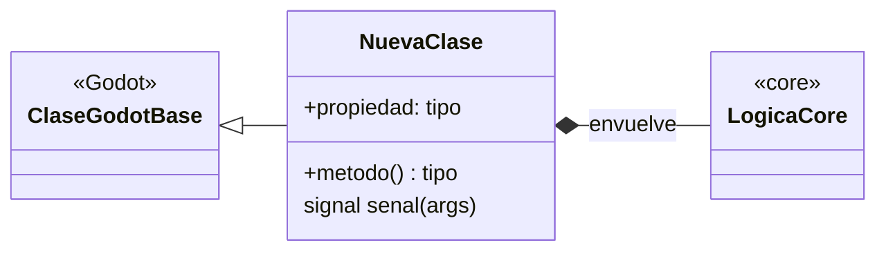

# Plantilla: sección de docs/ARQUITECTURA.md para un módulo terminado

~~~markdown
## N. Módulo M — <Nombre> (detalle)

### Problema que resuelve el diseño
<Qué necesidad hay y por qué la solución obvia no sirve.>

### Solución: <resumen en una línea>
<Explicación + ejemplo o fórmula.>

| Pieza | Patrón | Por qué |
|---|---|---|
| `<Clase>` | **<Patrón>** | <razón concreta> |

### Archivos
| Archivo | Qué es |
|---|---|
| `src/core/<modulo>.{h,cpp}` | <...> |
| `tests/test_<modulo>.cpp` | <N> tests: <casos> |
| `src/game/<clase>.{h,cpp}` | <...> |
| `project/...` | <escenas, scripts, datos> |

### Decisiones
- <Decisión y motivo.>
- <Pendientes que se anotaron en el ROADMAP.>
- Verificado en Godot: <qué se midió y resultado>.
~~~

Después de agregarla: actualizar el índice de patrones (última sección) y la tabla de módulos (§2).
