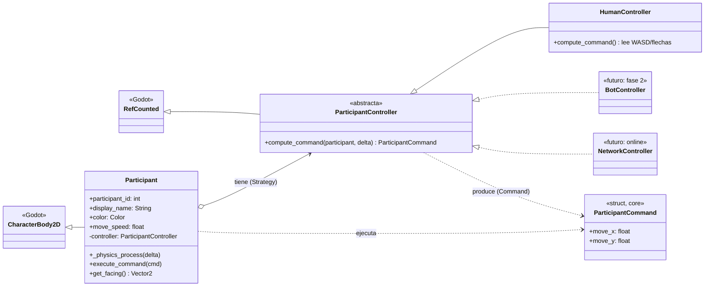
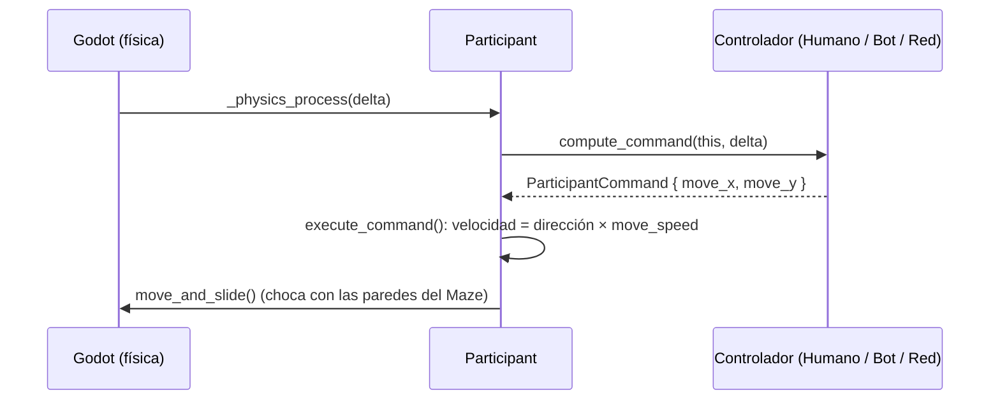
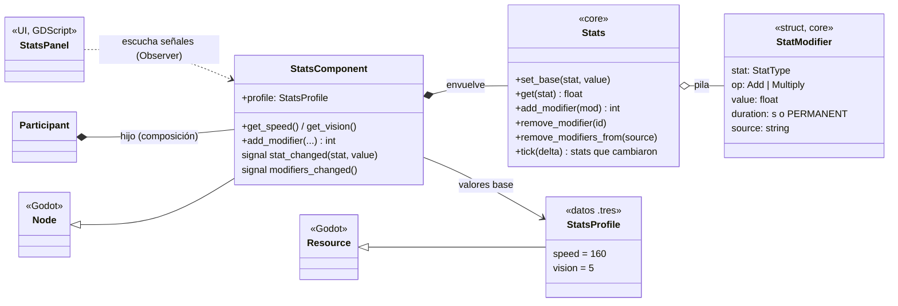
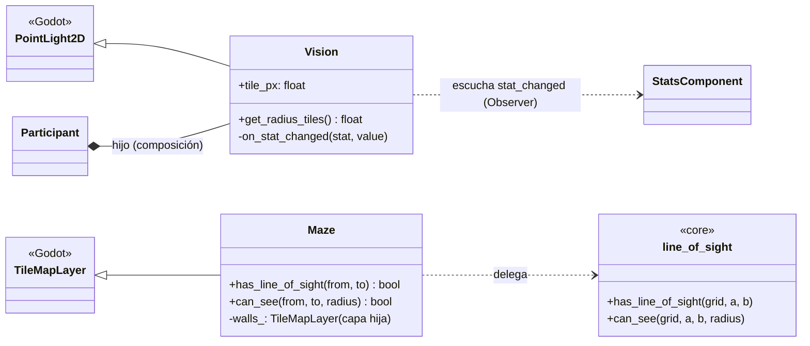

# Arquitectura

> Cómo está organizado el código y por qué. Complementa [VISION.md §15](VISION.md#15-arquitectura-y-patrones-de-diseño).
> Este documento crece módulo a módulo: solo se detalla lo que se está construyendo.

## 1. Principios

1. **Dos capas.**
   - **`core`** (C++ puro, namespace `lv::core`): reglas y algoritmos. No incluye nada de Godot.
     Se prueba con doctest en milisegundos, sin abrir el motor.
   - **`game`** (C++ con godot-cpp): nodos y recursos que Godot ve. Son **adaptadores**:
     traducen el mundo de Godot (posiciones, input, señales) a `core` y viceversa.
   - **GDScript** (`project/scripts`): solo interfaz (HUD, menús) y conectar escenas.
2. **El participante no sabe quién lo controla** (Strategy). Humano, bot o red producen las mismas órdenes.
3. **Composición sobre herencia.** Un participante *tiene* stats, visión, inventario; no *es* una subclase de cada cosa.
4. **Eventos en lugar de dependencias directas** (Observer / señales). Quien toma el trofeo no llama al HUD:
   emite `trophy_taken` y quien quiera escucha.
5. **Datos fuera del código** cuando varían por diseño (reglas, objetos): `Resource` de Godot o archivos.
6. **Un patrón solo si resuelve un problema actual.** Nada de capas "por si acaso".

```
┌──────────────────────── Godot ─────────────────────────┐
│  Escenas (.tscn) + GDScript (HUD, menús)               │
│        │ señales ▲                                     │
│        ▼         │                                     │
│  game/  (nodos C++: Maze, Participant, MatchManager…)  │
│        │ llama   ▲ eventos / resultados                │
└────────┼─────────┼─────────────────────────────────────┘
         ▼         │
   core/  (C++ puro: MazeGrid, MatchState, Stats…)   ◄── tests/ (doctest)
```

## 2. Mapa de módulos (fase 1 — prototipo)

| # | Módulo | `core` (lógica) | `game` (Godot) | Patrón |
|---|---|---|---|---|
| 1 | **Laberinto** | `MazeGrid`: cuadrícula pared/suelo, generación con semilla, bóveda central, bases | `Maze` (`TileMapLayer`): dibuja la cuadrícula y da colisiones | Builder (generación por pasos) |
| 2 | **Participante** | — | `Participant` (`CharacterBody2D`): se mueve según su controlador | Composición |
| 3 | **Controladores** | — | `ParticipantController` (base) → `HumanController`; luego `BotController` | **Strategy** |
| 4 | **Stats** | `Stats`: valores base + modificadores | expuesto como recurso del participante | **Decorator / modificadores** |
| 5 | **Visión** | `line_of_sight`: radio + línea de visión | `Vision` (`PointLight2D` con sombras) | Composición, Observer |
| 6 | **Objetos** | `Point`: tipo + efecto | sprites recolectables | **Factory + datos** |
| 7 | **Partida** | `MatchState`: reloj, trofeo, bases, victoria | `MatchManager` (`Node`): pasa posiciones a `core`, emite señales | **State** (fases), Observer |

Fases siguientes (bots, combate, vándalos, director) se diseñan cuando lleguemos; ver [ROADMAP](ROADMAP.md).

## 3. Flujo de un frame (cuando la fase 1 esté completa)

1. Cada `Participant` pregunta a su **controlador** hacia dónde moverse y se mueve (física de Godot).
2. `MatchManager` convierte la posición de cada participante a casilla y se la pasa a `MatchState`.
3. `MatchState` aplica las reglas (¿recogió un punto? ¿tomó el trofeo? ¿llegó a su base?) y devuelve **eventos**.
4. `MatchManager` traduce los eventos a **señales** de Godot.
5. La interfaz (GDScript) y otros sistemas escuchan las señales.

Así las reglas viven en un solo lugar testeable, y Godot solo se encarga de mover, dibujar y escuchar.

---

## 4. Módulo 1 — Laberinto (detalle)

### `lv::core::MazeGrid`

- Cuadrícula de `width × height` casillas; cada una es **pared** o **suelo**.
- Se genera a partir de `cells_w × cells_h` celdas lógicas. Cada celda es un pasillo de
  `corridor_width × corridor_width` casillas y **las paredes siempre miden 1 casilla** (paredes delgadas, pasillos anchos).
  Tamaño final: `(cells_w·(corridor_width+1)+1) × (cells_h·(corridor_width+1)+1)`.
- **Generación por pasos** (cada paso es una función separada, fácil de cambiar o probar):
  1. *Backtracking iterativo* → laberinto "perfecto" (un solo camino entre dos puntos), en una cuadrícula compacta.
  2. *Bucles*: abre paredes extra con probabilidad `loop_chance` → rutas alternativas para huir y emboscar.
  3. *Ensanchar*: escala la cuadrícula compacta al ancho de pasillo final.
  4. *Bóveda*: sala abierta en el centro (donde estará el trofeo).
- **Determinista por semilla:** misma semilla = mismo laberinto (útil para tests, repeticiones y multijugador).
- Consultas: `is_wall`, `floor_cells`, `center`, `is_in_vault`, `base_cells(n)` (esquinas primero), `is_fully_connected`.

**Tests:** dimensiones correctas; borde siempre pared; todo el suelo conectado; misma semilla → mismo resultado;
bóveda abierta; bases en suelo y distintas entre sí; pasillos anchos (2, 3 y 4 casillas) conectados.

### `Maze` (nodo Godot, hereda `TileMapLayer`)

- Propiedades editables en el inspector: `cells_width` (20), `cells_height` (14), `corridor_width` (3),
  `seed` (0 = aleatoria), `loop_chance` (0.12), `vault_radius` (4). Con los valores por defecto: 81×57 casillas de 16 px.
- `generate()`: crea el `MazeGrid` y pinta las casillas. Emite la señal `generated`.
- Si no tiene `TileSet` asignado, crea uno **provisional** (dos colores, con colisión en las paredes),
  para no depender de arte todavía. Con arte de Kenney solo se asigna otro `TileSet`.
- Consultas para el resto del juego: `is_wall(cell)`, `get_center_cell()`, `get_base_cells(n)`,
  `cell_to_world(cell)`, `world_to_cell(pos)`.

### Fuera de alcance del módulo 1
Mutación en tiempo real, portales, pasadizos secretos (fase 6 "Mapa vivo").


---

## 5. Módulo 2 — Participante (detalle)

### Problema que resuelve el diseño
Un participante puede ser controlado por una persona, un bot o (en el futuro) otro jugador por internet.
Si el participante leyera el teclado directamente, habría que reescribirlo para cada caso.

### Solución: Strategy + Command



Cada frame:



| Pieza | Patrón | Por qué |
|---|---|---|
| `ParticipantController` → `HumanController` | **Strategy** | Cambiar quién controla sin tocar `Participant`. Los bots (fase 2) serán otra estrategia. |
| `ParticipantCommand` | **Command** | La orden es un dato: se puede mandar por red, grabar para repeticiones o generar por la IA. |
| `Participant` + escena con `View` | **Composición** y separación lógica/visual | La lógica (C++) no dibuja; la vista (`participant_view.gd`) no decide. Cambiar el arte no toca la lógica. |
| Herencia | Corta, solo donde hay "es un" real | `HumanController` *es un* controlador. El resto se compone. |

### Archivos
| Archivo | Qué es |
|---|---|
| `src/core/participant_command.h` | La orden (Command), dato puro |
| `src/game/participant_controller.{h,cpp}` | `ParticipantController` (base, registrada como abstracta) y `HumanController` |
| `src/game/participant.{h,cpp}` | `Participant` (`CharacterBody2D`, movimiento flotante top-down) |
| `project/scenes/participant/participant.tscn` | Escena: cuerpo + colisión circular (r = 11 px) + vista |
| `project/scripts/participant/participant_view.gd` | Vista provisional (círculo + dirección) |
| `project/scenes/sandbox/participant_sandbox.tscn` | Prueba: laberinto + participante + cámara que lo sigue |

Controles (acciones del InputMap en `project.godot`): `move_left/right/up/down` = WASD y flechas.

### Decisiones y pendientes
- La velocidad viene del componente `Stats` (ver §6).
- **`ParticipantController` hereda de `RefCounted`** (no de `Node`): no necesita estar en el árbol de escena
  y cada participante tiene su propia instancia.
- **Movimiento libre (no casilla por casilla)** con `motion_mode = floating`: se siente más fluido para persecuciones.
- Verificado: se mueve a `move_speed` px/s y se detiene al chocar con las paredes.

---

## 6. Módulo 3 — Stats (detalle)

### Problema que resuelve el diseño
La velocidad (y luego la visión, resistencia, ataque) cambia por muchas causas a la vez: puntos permanentes,
power-ups temporales, llevar el trofeo. Si cada sistema modificara el número directamente, se pisarían
entre sí y nadie sabría cuál es el valor real ni cómo deshacer un efecto.

### Solución: valor base + pila de modificadores

```
valor final = clamp( (base + Σ sumas) × Π multiplicadores , mínimo, máximo )

ejemplo:  (160 + 10 punto) × 1.5 power-up × 0.6 trofeo = 153 px/s
```

Cada modificador lleva **origen** (`source`) y **duración**. Los temporales vencen solos; los de un origen
se quitan juntos (al soltar el trofeo se quita solo el `×0.6` del trofeo).

> **Sobre el patrón:** es la variante de **Decorator** que se usa en juegos. El Decorator clásico envuelve
> objetos uno dentro de otro; aquí los "envoltorios" son entradas en una lista. Mismo efecto (apilar
> modificaciones sin tocar el valor base), pero más fácil de leer, quitar, serializar y probar.



| Pieza | Patrón | Por qué |
|---|---|---|
| `Stats` + `StatModifier` (core) | **Modificadores (Decorator)** | Apilar y quitar efectos sin tocar el valor base. 6 tests. |
| `StatsComponent` hijo de `Participant` | **Composición** | El participante *tiene* stats; bots y vándalos reutilizarán el mismo componente. |
| `stat_changed` / `modifiers_changed` | **Observer** (señales) | El panel (y luego la visión) reaccionan sin que el componente los conozca. |
| `StatsProfile` (`.tres`) | **Datos fuera del código** | Cada personaje tendrá su perfil; se edita en el inspector de Godot. |

### Archivos
| Archivo | Qué es |
|---|---|
| `src/core/stats.{h,cpp}` | Lógica: base, modificadores, vencimiento, límites |
| `tests/test_stats.cpp` | 6 tests: orden suma→multiplica, por stat, vencimiento, quitar por id/origen, límites |
| `src/game/stats_profile.{h,cpp}` | Recurso con valores base |
| `src/game/stats_component.{h,cpp}` | Nodo componente; constantes `STAT_SPEED`, `STAT_VISION`, `OP_ADD`, `OP_MULTIPLY` |
| `project/data/stats/default_participant.tres` | Perfil por defecto (160 px/s, 5 casillas) |
| `project/scenes/ui/stats_panel.tscn` + `scripts/ui/stats_panel.gd` | Panel de interfaz arriba a la izquierda |

### Decisiones
- **Límites de seguridad:** velocidad 20–600 px/s, visión 1–20 casillas (ningún efecto deja inmóvil o ciego).
- `Participant` busca su `StatsComponent` entre sus hijos al iniciar; sin él no se mueve y avisa con un warning.
- La visión todavía no tiene efecto visible: la usa la pieza 4 (niebla de guerra).
- Verificado en Godot: 160 px/s base → 240 px/s con power-up ×1.5 → vuelve a 160 al vencer.

---

## 7. Módulo 4 — Visión limitada (detalle)

### Problema que resuelve el diseño
Dos necesidades distintas que no conviene mezclar:
1. **Lo que ve la persona** en pantalla: oscuridad salvo cerca de su participante, sin ver a través de las paredes.
2. **Lo que "sabe" cada participante** para la lógica: un bot no debe reaccionar a algo que no podría ver (si no, hace trampa).

### Solución: lógica en `core`, efecto visual con las luces 2D de Godot

| Necesidad | Solución | Dónde |
|---|---|---|
| Regla "¿A ve a B?" | Radio + línea de visión sobre la cuadrícula (algoritmo DDA) | `lv::core::can_see` (core, 6 tests) → `Maze.can_see()` |
| Efecto en pantalla | `PointLight2D` con sombras + `CanvasModulate` oscuro en el nivel | `Vision` (hijo del participante) |
| Paredes que tapan | Oclusores en la casilla de pared del TileSet | `Maze` |
| Ver las paredes cercanas pero no lo de detrás | Paredes en una capa hija con su propia máscara de luz: la luz las ilumina pero no las sombrea | `Maze` (capa `Walls`, `WALLS_LIGHT_MASK = 2`) |



| Pieza | Patrón | Por qué |
|---|---|---|
| `Vision` hijo de `Participant` | **Composición** | Se agrega o quita sin tocar al participante. Los bots no la necesitan. |
| `Vision` escucha `stat_changed` | **Observer** | El power-up de visión agranda el radio solo (con transición suave). |
| `line_of_sight` en `core` | **Lógica separada de la vista** | Regla testeable y reutilizable por la IA; la luz solo es la representación. |

### Archivos
| Archivo | Qué es |
|---|---|
| `src/core/line_of_sight.{h,cpp}` | `has_line_of_sight`, `can_see` (puntos en coordenadas de casilla con decimales) |
| `tests/test_line_of_sight.cpp` | 6 tests: sala abierta, pared bloquea, desde/hacia pared, misma casilla, radio, simetría |
| `src/game/vision.{h,cpp}` | Luz de visión con radio = stat `vision` × tamaño de casilla |
| `src/game/maze.{h,cpp}` | Oclusores, capa `Walls`, `has_line_of_sight`/`can_see` |

### Decisiones
- **Radio en casillas** (stat `vision`, por defecto 5): con pasillos de 3 casillas se ve aproximadamente un tramo y medio.
- **Esquinas diagonales:** si dos paredes se tocan en diagonal, no se ve entre ellas.
- **Solo hay una luz por pantalla:** con varios humanos en la misma máquina (multijugador local) habrá que decidir pantalla dividida u otra solución. Anotado en el ROADMAP.
- Para que haya oscuridad, el nivel debe tener un `CanvasModulate` oscuro (el sandbox lo tiene; tecla **V** lo apaga para depurar).
- Verificado en Godot: radio 5 → 7 con el power-up de visión (+2); `can_see` es falso a través del borde y fuera de radio.

---

## 8. Patrones aplicados (índice)

| Patrón | Dónde | Estado |
|---|---|---|
| Builder (pasos de generación) | `MazeGrid::generate` | ✅ |
| Strategy | `ParticipantController` | ✅ |
| Command | `ParticipantCommand` | ✅ |
| Composición / separación lógica-vista | `Participant` + `View` + `StatsComponent` + `Vision`; `core` vs `game`; `line_of_sight` vs luz | ✅ |
| Decorator / modificadores | `Stats` + `StatModifier` | ✅ |
| Observer / señales | `StatsComponent` → `StatsPanel`, `Vision`; luego `MatchManager` | ✅ (parcial) |
| State | Fases de la partida, estados del participante | Pieza 7 / fase 3 |
| Datos fuera del código | `StatsProfile` (.tres) | ✅ |
| Factory + datos | Objetos recolectables | Pieza 5 |