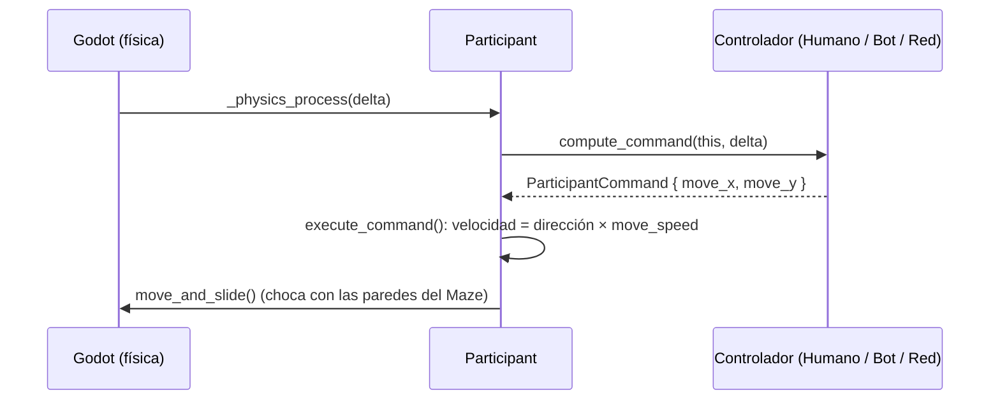
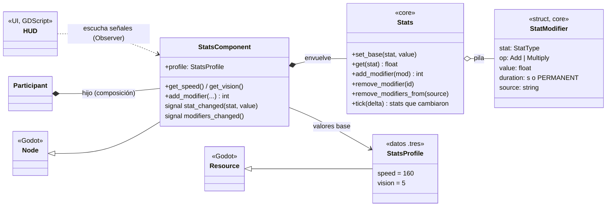
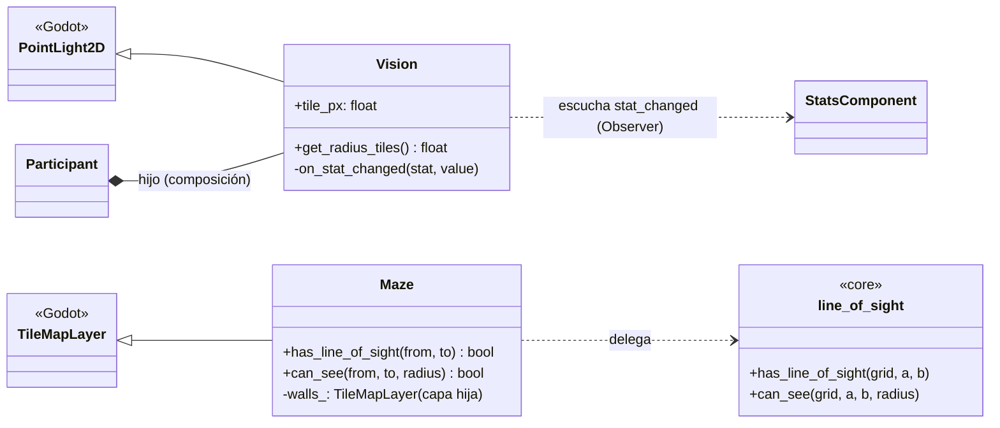
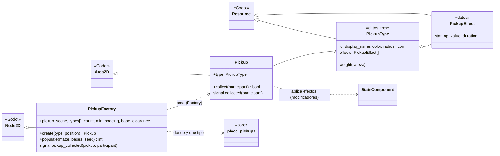
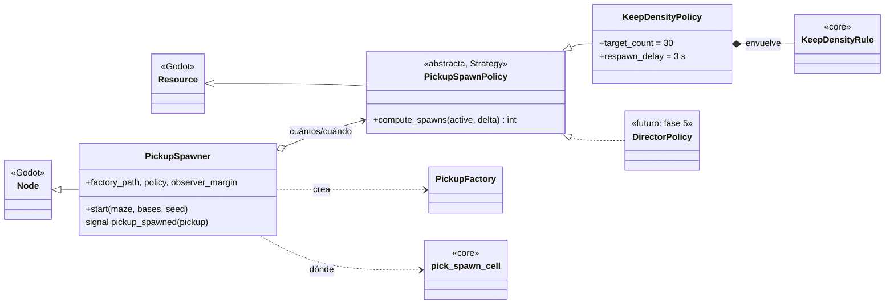
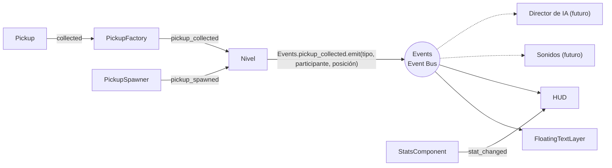
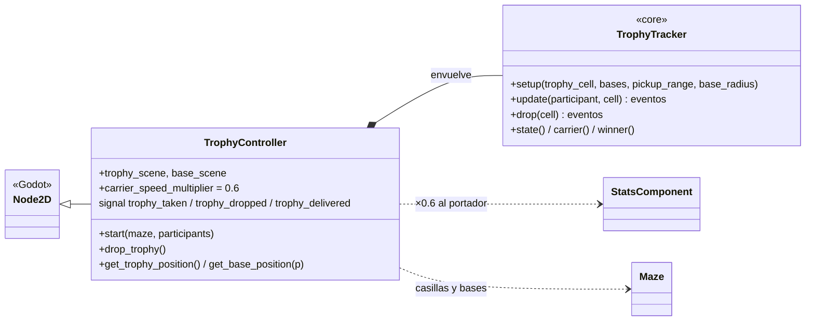
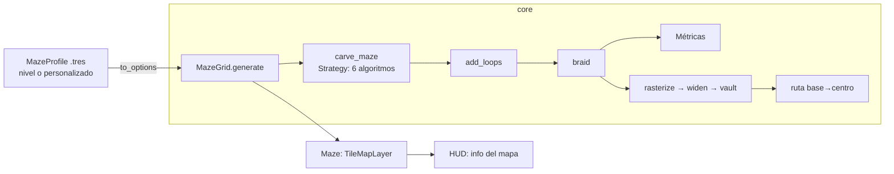
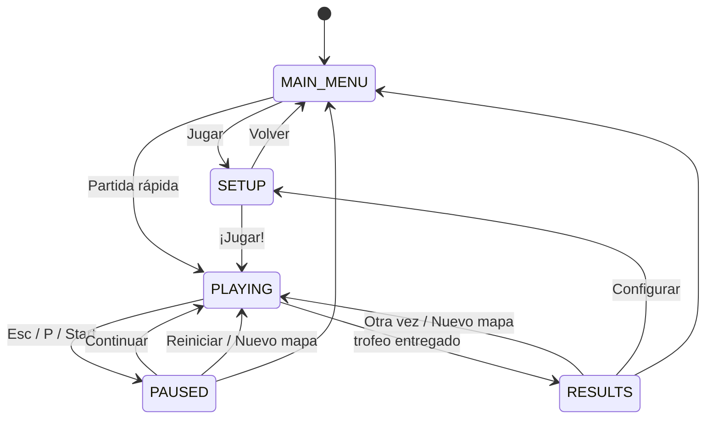

# Arquitectura

> Cómo está organizado el código y por qué. Complementa [VISION.md §15](VISION.md#15-arquitectura-y-patrones-de-diseño).
> Este documento crece módulo a módulo: solo se detalla lo que se está construyendo.

## 1. Principios

1. **Dos capas.**
   - **`core`** (C++ puro, namespace `lv::core`): reglas y algoritmos. No incluye nada de Godot.
     Se prueba con doctest en milisegundos, sin abrir el motor.
   - **`game`** (C++ con godot-cpp): nodos y recursos que Godot ve. Son **adaptadores**:
     traducen el mundo de Godot (posiciones, input, señales) a `core` y viceversa.
   - **GDScript** (`project/scripts`): solo interfaz (HUD, menús) y conectar escenas.
2. **El participante no sabe quién lo controla** (Strategy). Humano, bot o red producen las mismas órdenes.
3. **Composición sobre herencia.** Un participante *tiene* stats, visión, inventario; no *es* una subclase de cada cosa.
4. **Eventos en lugar de dependencias directas** (Observer / señales). Quien toma el trofeo no llama al HUD:
   emite `trophy_taken` y quien quiera escucha.
5. **Datos fuera del código** cuando varían por diseño (reglas, objetos): `Resource` de Godot o archivos.
6. **Un patrón solo si resuelve un problema actual.** Nada de capas "por si acaso".

```
┌──────────────────────── Godot ─────────────────────────┐
│  Escenas (.tscn) + GDScript (HUD, menús)               │
│        │ señales ▲                                     │
│        ▼         │                                     │
│  game/  (nodos C++: Maze, Participant, MatchManager…)  │
│        │ llama   ▲ eventos / resultados                │
└────────┼─────────┼─────────────────────────────────────┘
         ▼         │
   core/  (C++ puro: MazeGrid, MatchState, Stats…)   ◄── tests/ (doctest)
```

## 2. Mapa de módulos (fase 1 — prototipo)

| # | Módulo | `core` (lógica) | `game` (Godot) | Patrón |
|---|---|---|---|---|
| 1 | **Laberinto** | `MazeGrid`: cuadrícula pared/suelo, generación con semilla, bóveda central, bases | `Maze` (`TileMapLayer`): dibuja la cuadrícula y da colisiones | Builder (generación por pasos) |
| 2 | **Participante** | — | `Participant` (`CharacterBody2D`): se mueve según su controlador | Composición |
| 3 | **Controladores** | — | `ParticipantController` (base) → `HumanController`; luego `BotController` | **Strategy** |
| 4 | **Stats** | `Stats`: valores base + modificadores | expuesto como recurso del participante | **Decorator / modificadores** |
| 5 | **Visión** | `line_of_sight`: radio + línea de visión | `Vision` (`PointLight2D` con sombras) | Composición, Observer |
| 6 | **Objetos** | `place_pickups` (dónde/qué tipo), `Rng` | `PickupType` (datos), `Pickup`, `PickupFactory` | **Factory + datos**, Observer |
| 7 | **Trofeo y bases** | `TrophyTracker` | `TrophyController` + vistas | **State**, Observer, Factory |
| 8 | **Partida** | reloj, fases, victoria/tiempo | gestor de partida | **State** (fases), Observer |

Fases siguientes (bots, combate, vándalos, director) se diseñan cuando lleguemos; ver [ROADMAP](ROADMAP.md).

## 3. Flujo de un frame (cuando la fase 1 esté completa)

1. Cada `Participant` pregunta a su **controlador** hacia dónde moverse y se mueve (física de Godot).
2. `MatchManager` convierte la posición de cada participante a casilla y se la pasa a `MatchState`.
3. `MatchState` aplica las reglas (¿recogió un punto? ¿tomó el trofeo? ¿llegó a su base?) y devuelve **eventos**.
4. `MatchManager` traduce los eventos a **señales** de Godot.
5. La interfaz (GDScript) y otros sistemas escuchan las señales.

Así las reglas viven en un solo lugar testeable, y Godot solo se encarga de mover, dibujar y escuchar.

---

## 4. Módulo 1 — Laberinto (detalle)

### `lv::core::MazeGrid`

- Cuadrícula de `width × height` casillas; cada una es **pared** o **suelo**.
- Se genera a partir de `cells_w × cells_h` celdas lógicas. Cada celda es un pasillo de
  `corridor_width × corridor_width` casillas y **las paredes siempre miden 1 casilla** (paredes delgadas, pasillos anchos).
  Tamaño final: `(cells_w·(corridor_width+1)+1) × (cells_h·(corridor_width+1)+1)`.
- **Generación por pasos** (cada paso es una función separada, fácil de cambiar o probar):
  1. *Backtracking iterativo* → laberinto "perfecto" (un solo camino entre dos puntos), en una cuadrícula compacta.
     Usa `lv::core::Rng` (aleatorio portable, ver §8) para que la semilla dé el mismo laberinto en todas las plataformas.
  2. *Bucles*: abre paredes extra con probabilidad `loop_chance` → rutas alternativas para huir y emboscar.
  3. *Ensanchar*: escala la cuadrícula compacta al ancho de pasillo final.
  4. *Bóveda*: sala abierta en el centro (donde estará el trofeo).
- **Determinista por semilla:** misma semilla = mismo laberinto (útil para tests, repeticiones y multijugador).
- Consultas: `is_wall`, `floor_cells`, `center`, `is_in_vault`, `base_cells(n)` (esquinas primero), `is_fully_connected`.

**Tests:** dimensiones correctas; borde siempre pared; todo el suelo conectado; misma semilla → mismo resultado;
bóveda abierta; bases en suelo y distintas entre sí; pasillos anchos (2, 3 y 4 casillas) conectados.

### `Maze` (nodo Godot, hereda `TileMapLayer`)

- Propiedades editables en el inspector: `cells_width` (20), `cells_height` (14), `corridor_width` (3),
  `seed` (0 = aleatoria), `loop_chance` (0.12), `vault_radius` (4). Con los valores por defecto: 81×57 casillas de 16 px.
- `generate()`: crea el `MazeGrid` y pinta las casillas. Emite la señal `generated`.
- Si no tiene `TileSet` asignado, crea uno **provisional** (dos colores, con colisión en las paredes),
  para no depender de arte todavía. Con arte de Kenney solo se asigna otro `TileSet`.
- Consultas para el resto del juego: `is_wall(cell)`, `get_center_cell()`, `get_base_cells(n)`,
  `cell_to_world(cell)`, `world_to_cell(pos)`.

### Fuera de alcance del módulo 1
Mutación en tiempo real, portales, pasadizos secretos (fase 6 "Mapa vivo").


---

## 5. Módulo 2 — Participante (detalle)

### Problema que resuelve el diseño
Un participante puede ser controlado por una persona, un bot o (en el futuro) otro jugador por internet.
Si el participante leyera el teclado directamente, habría que reescribirlo para cada caso.

### Solución: Strategy + Command


Cada frame:



| Pieza | Patrón | Por qué |
|---|---|---|
| `ParticipantController` → `HumanController` | **Strategy** | Cambiar quién controla sin tocar `Participant`. Los bots (fase 2) serán otra estrategia. |
| `ParticipantCommand` | **Command** | La orden es un dato: se puede mandar por red, grabar para repeticiones o generar por la IA. |
| `Participant` + escena con `View` | **Composición** y separación lógica/visual | La lógica (C++) no dibuja; la vista (`participant_view.gd`) no decide. Cambiar el arte no toca la lógica. |
| Herencia | Corta, solo donde hay "es un" real | `HumanController` *es un* controlador. El resto se compone. |

### Archivos
| Archivo | Qué es |
|---|---|
| `src/core/participant_command.h` | La orden (Command), dato puro |
| `src/game/participant_controller.{h,cpp}` | `ParticipantController` (base, registrada como abstracta) y `HumanController` |
| `src/game/participant.{h,cpp}` | `Participant` (`CharacterBody2D`, movimiento flotante top-down) |
| `project/scenes/participant/participant.tscn` | Escena: cuerpo + colisión circular (r = 11 px) + vista |
| `project/scripts/participant/participant_view.gd` | Vista provisional (círculo + dirección) |
| `project/scenes/sandbox/participant_sandbox.tscn` | Prueba: laberinto + participante + cámara que lo sigue |

Controles (acciones del InputMap en `project.godot`): `move_left/right/up/down` = WASD y flechas.

### Decisiones y pendientes
- La velocidad viene del componente `Stats` (ver §6).
- **`ParticipantController` hereda de `RefCounted`** (no de `Node`): no necesita estar en el árbol de escena
  y cada participante tiene su propia instancia.
- **Movimiento libre (no casilla por casilla)** con `motion_mode = floating`: se siente más fluido para persecuciones.
- Verificado: se mueve a `move_speed` px/s y se detiene al chocar con las paredes.

---

## 6. Módulo 3 — Stats (detalle)

### Problema que resuelve el diseño
La velocidad (y luego la visión, resistencia, ataque) cambia por muchas causas a la vez: puntos permanentes,
power-ups temporales, llevar el trofeo. Si cada sistema modificara el número directamente, se pisarían
entre sí y nadie sabría cuál es el valor real ni cómo deshacer un efecto.

### Solución: valor base + pila de modificadores

```
valor final = clamp( (base + Σ sumas) × Π multiplicadores , mínimo, máximo )

ejemplo:  (160 + 10 punto) × 1.5 power-up × 0.6 trofeo = 153 px/s
```

Cada modificador lleva **origen** (`source`) y **duración**. Los temporales vencen solos; los de un origen
se quitan juntos (al soltar el trofeo se quita solo el `×0.6` del trofeo).

> **Sobre el patrón:** es la variante de **Decorator** que se usa en juegos. El Decorator clásico envuelve
> objetos uno dentro de otro; aquí los "envoltorios" son entradas en una lista. Mismo efecto (apilar
> modificaciones sin tocar el valor base), pero más fácil de leer, quitar, serializar y probar.



| Pieza | Patrón | Por qué |
|---|---|---|
| `Stats` + `StatModifier` (core) | **Modificadores (Decorator)** | Apilar y quitar efectos sin tocar el valor base. 6 tests. |
| `StatsComponent` hijo de `Participant` | **Composición** | El participante *tiene* stats; bots y vándalos reutilizarán el mismo componente. |
| `stat_changed` / `modifiers_changed` | **Observer** (señales) | El HUD y la visión reaccionan sin que el componente los conozca. |
| `StatsProfile` (`.tres`) | **Datos fuera del código** | Cada personaje tendrá su perfil; se edita en el inspector de Godot. |

### Archivos
| Archivo | Qué es |
|---|---|
| `src/core/stats.{h,cpp}` | Lógica: base, modificadores, vencimiento, límites |
| `tests/test_stats.cpp` | 6 tests: orden suma→multiplica, por stat, vencimiento, quitar por id/origen, límites |
| `src/game/stats_profile.{h,cpp}` | Recurso con valores base |
| `src/game/stats_component.{h,cpp}` | Nodo componente; constantes `STAT_SPEED`, `STAT_VISION`, `OP_ADD`, `OP_MULTIPLY` |
| `project/data/stats/default_participant.tres` | Perfil por defecto (160 px/s, 5 casillas) |
| ~~`StatsPanel`~~ | Reemplazado por el `HUD` (§10) |

### Decisiones
- **Límites de seguridad:** velocidad 20–600 px/s, visión 1–20 casillas (ningún efecto deja inmóvil o ciego).
- `Participant` busca su `StatsComponent` entre sus hijos al iniciar; sin él no se mueve y avisa con un warning.
- La visión todavía no tiene efecto visible: la usa la pieza 4 (niebla de guerra).
- Verificado en Godot: 160 px/s base → 240 px/s con power-up ×1.5 → vuelve a 160 al vencer.

---

## 7. Módulo 4 — Visión limitada (detalle)

### Problema que resuelve el diseño
Dos necesidades distintas que no conviene mezclar:
1. **Lo que ve la persona** en pantalla: oscuridad salvo cerca de su participante, sin ver a través de las paredes.
2. **Lo que "sabe" cada participante** para la lógica: un bot no debe reaccionar a algo que no podría ver (si no, hace trampa).

### Solución: lógica en `core`, efecto visual con las luces 2D de Godot

| Necesidad | Solución | Dónde |
|---|---|---|
| Regla "¿A ve a B?" | Radio + línea de visión sobre la cuadrícula (algoritmo DDA) | `lv::core::can_see` (core, 6 tests) → `Maze.can_see()` |
| Efecto en pantalla | `PointLight2D` con sombras + `CanvasModulate` oscuro en el nivel | `Vision` (hijo del participante) |
| Paredes que tapan | Oclusores en la casilla de pared del TileSet | `Maze` |
| Ver las paredes cercanas pero no lo de detrás | Paredes en una capa hija con su propia máscara de luz: la luz las ilumina pero no las sombrea | `Maze` (capa `Walls`, `WALLS_LIGHT_MASK = 2`) |



| Pieza | Patrón | Por qué |
|---|---|---|
| `Vision` hijo de `Participant` | **Composición** | Se agrega o quita sin tocar al participante. Los bots no la necesitan. |
| `Vision` escucha `stat_changed` | **Observer** | El power-up de visión agranda el radio solo (con transición suave). |
| `line_of_sight` en `core` | **Lógica separada de la vista** | Regla testeable y reutilizable por la IA; la luz solo es la representación. |

### Archivos
| Archivo | Qué es |
|---|---|
| `src/core/line_of_sight.{h,cpp}` | `has_line_of_sight`, `can_see` (puntos en coordenadas de casilla con decimales) |
| `tests/test_line_of_sight.cpp` | 6 tests: sala abierta, pared bloquea, desde/hacia pared, misma casilla, radio, simetría |
| `src/game/vision.{h,cpp}` | Luz de visión con radio = stat `vision` × tamaño de casilla |
| `src/game/maze.{h,cpp}` | Oclusores, capa `Walls`, `has_line_of_sight`/`can_see` |

### Decisiones
- **Radio en casillas** (stat `vision`, por defecto 5): con pasillos de 3 casillas se ve aproximadamente un tramo y medio.
- **Esquinas diagonales:** si dos paredes se tocan en diagonal, no se ve entre ellas.
- **Solo hay una luz por pantalla:** con varios humanos en la misma máquina (multijugador local) habrá que decidir pantalla dividida u otra solución. Anotado en el ROADMAP.
- Para que haya oscuridad, el nivel debe tener un `CanvasModulate` oscuro (el sandbox lo tiene; tecla **V** lo apaga para depurar).
- Verificado en Godot: radio 5 → 7 con el power-up de visión (+2); `can_see` es falso a través del borde y fuera de radio.

---

## 8. Módulo 5 — Objetos recolectables (detalle)

### Problema que resuelve el diseño
Habrá muchos tipos de objetos (puntos, power-ups, pociones, escudos, bombas...). Si cada tipo se
programara a mano, cada objeto nuevo sería código nuevo, recompilar y riesgo de romper otros.

### Solución: tipos como datos + fábrica

Cada tipo es un archivo `.tres` (`PickupType`) con nombre, color, rareza (`weight`) y una lista de
efectos (`PickupEffect`: stat, sumar/multiplicar, valor, duración). **Agregar un objeto = crear un archivo.**
Los efectos se aplican como modificadores de Stats (§6), así que no hay un segundo sistema de efectos.



| Pieza | Patrón | Por qué |
|---|---|---|
| `PickupType` / `PickupEffect` (`.tres`) | **Datos fuera del código** | Diseñar objetos sin programar; se editan en el inspector. |
| `PickupFactory.create()` | **Factory** | Un solo lugar sabe cómo armar un objeto (escena + tipo + conexiones). |
| `place_pickups` (core) | Lógica pura | Reglas de colocación testeadas: suelo, fuera de bóveda, lejos de bases, separación, rareza. |
| `collected` → `pickup_collected` | **Observer** | La interfaz (y luego el Director de IA) se entera sin que el objeto la conozca. La fábrica reenvía las señales para conectarse una sola vez. |
| Efectos = modificadores | Reutiliza **Decorator** (§6) | Un power-up temporal vence solo; un punto es permanente. |

### Aleatoriedad portable (`core/random.h`)
Las distribuciones de la biblioteca estándar de C++ (`uniform_int_distribution`, `shuffle`, etc.) dan
resultados distintos según el compilador. Para que **una semilla produzca el mismo laberinto y los mismos
objetos en Windows, Linux y en red**, todo `core` usa `lv::core::Rng` (mt19937 + funciones propias).
`MazeGrid` también se migró a `Rng` en esta pieza.

### Archivos
| Archivo | Qué es |
|---|---|
| `src/core/random.h` | `Rng`: `range`, `unit`, `chance`, `shuffle`, `weighted` deterministas |
| `src/core/pickup_placer.{h,cpp}` | `place_pickups`: dónde y de qué tipo |
| `tests/test_pickup_placer.cpp` | 8 tests (3 de `Rng`, 5 de colocación) |
| `src/game/pickup_type.{h,cpp}` | `PickupEffect`, `PickupType` |
| `src/game/pickup.{h,cpp}` | `Pickup` (`Area2D`) |
| `src/game/pickup_factory.{h,cpp}` | `PickupFactory` |
| `project/data/pickups/*.tres` | `punto_velocidad` (+8 vel, común), `punto_vision` (+0.5 visión, común), `powerup_rapidez` (×1.5 vel 6 s, raro) |
| `project/scenes/pickups/pickup.tscn` + `scripts/pickups/pickup_view.gd` | Escena y vista provisional (círculo común, rombo raro) |

### Decisiones
- Los objetos se colocan con **la misma semilla que el laberinto**: misma partida = mismos objetos.
- Quedan libres 6 casillas alrededor de cada base y la bóveda completa.
- `Pickup.collect()` es público: la IA o la red podrán recoger sin depender de la física.
- **Visión gratis:** los objetos usan la máscara de luz normal, así que quedan ocultos en la sombra.
- No reaparecen: lo decidirá el Director de IA (fase 5). Anotado en el ROADMAP.
- Verificado en Godot: 30 objetos (14/13/3), ninguno en paredes; recoger aplica +8 y ×1.5 (160 → 168 → 252) y el contador sube.

---

## 9. Bloque UX-1 — Objetos infinitos (reaparición)

### Problema que resuelve el diseño
Con objetos fijos, el mapa se vacía y deja de haber motivo para explorar. Además, "cuántos y cuándo
aparecen" es justo lo que el **Director de IA** (fase 5) querrá controlar: no debe quedar fijo en el código.

### Solución: separar CUÁNTOS/CUÁNDO, DÓNDE y CÓMO

| Pregunta | Responde | Patrón |
|---|---|---|
| ¿Cuántos y cuándo? | `PickupSpawnPolicy` (hoy `KeepDensityPolicy`: mantener 30, uno cada 3 s) | **Strategy** (y es un `Resource`: se elige y ajusta en el inspector) |
| ¿Dónde? | `lv::core::pick_spawn_cell`: suelo, fuera de bóveda, lejos de bases y de otros objetos, **fuera de la vista de todos los participantes** | Lógica pura (tests) |
| ¿Cómo se crea? | `PickupFactory.create()` (§8) | **Factory** |
| ¿Quién se entera? | Señal `pickup_spawned` | **Observer** |



### Archivos
| Archivo | Qué es |
|---|---|
| `src/core/pickup_spawning.{h,cpp}` | `pick_spawn_cell`, `SpawnObserver`, `KeepDensityRule` |
| `tests/test_pickup_spawning.cpp` | 7 tests: restricciones y fuera de vista, determinismo, sin lugar, reglas de densidad |
| `src/game/pickup_spawn_policy.h` | `PickupSpawnPolicy` (abstracta) y `KeepDensityPolicy` |
| `src/game/pickup_spawner.{h,cpp}` | `PickupSpawner` |
| `project/data/spawning/keep_density_default.tres` | Política por defecto (30 objetos, 3 s) |

### Decisiones
- **Nunca aparece nada frente a un participante:** se descarta cualquier casilla que un participante pueda ver
  (radio de visión + 2 casillas de margen, respetando paredes). Los participantes se encuentran por el grupo `participants`.
- Semilla derivada de la del laberinto: misma partida = mismas reapariciones (repeticiones, red).
- La política es `local_to_scene`: cada spawner tiene su propio reloj aunque compartan el archivo.
- Los objetos aparecen con una animación de rebote (vista).
- Verificado en Godot: 30 → recoger 10 → 20 → +1 cada 3 s → vuelve a 30 y se mantiene; 0 reapariciones a la vista del jugador.

---

## 10. Bloque UX-2 — HUD limpio y textos flotantes

### Problema que resuelve el diseño
La información tapaba el juego (panel y ayuda encima) y las acciones casi no se notaban. Además, si cada
pieza de interfaz se conectara directamente a cada objeto/participante/sistema, todo quedaría enredado.

### Solución
- **El centro de la pantalla siempre libre**: barra superior delgada y semitransparente; ayuda escondida en **F1**.
- **Respuesta inmediata ("game feel")**: textos flotantes, números que cuentan y destellan, fichas de efecto con temporizador.
- **Event Bus** (`Events`, autoload): los niveles publican eventos de juego; la interfaz escucha ahí.



| Pieza | Patrón | Por qué |
|---|---|---|
| `Events` (autoload `scripts/autoload/events.gd`) | **Event Bus** | Productores y consumidores no se conocen. Agregar sonidos o el Director = escuchar el mismo evento. Regla: solo eventos ya ocurridos (en pasado), nada de órdenes. |
| `FloatingTextLayer` | **Object Pool** | 20 etiquetas creadas una vez y reutilizadas; si se llenan, recicla la más antigua. Sin tirones con muchos textos. |
| `HUD` | **Observer** | Solo muestra; escucha `StatsComponent.stat_changed` y `Events`. Nunca modifica el juego. |
| `EffectText` | Texto a partir de los datos | `+8 VEL`, `×1.5 VEL`, `¡RAPIDEZ! ×1.5 VEL` salen de los `PickupEffect`; un objeto nuevo no requiere programar su texto. |

### Detalles de diseño de interfaz
- **Barra superior** (38 px): color del jugador · `VEL` · `VIS` · fichas de efectos **temporales** (los permanentes ya
  se ven en el valor) · `OBJ` a la derecha (el reloj de partida irá ahí en la pieza 7).
- **Números que cuentan** (0,35 s), destello verde si sube o rojo si baja, y un pequeño "pop" de escala.
- **Fichas de efecto**: entran con destello, la barra se vacía según el tiempo restante y salen desvaneciéndose.
- **Textos flotantes**: en pantalla (no en el mundo) para que se vean nítidos con cualquier zoom y no los oscurezca la
  niebla; siguen el punto del mundo donde ocurrió el evento, suben frenando y se desvanecen. Los destacados
  (con `popup_title`) son más grandes y rebotan.
- **F1**: panel de controles centrado (el único elemento que tapa el centro, y solo cuando se pide). La pista
  "F1 · controles" se desvanece a los 5 s. Cada escena define su propio texto de controles.
- Estilos neutros provisionales: el bloque 3 (identidad visual) los reemplaza con un Theme.

### Archivos
| Archivo | Qué es |
|---|---|
| `project/scripts/autoload/events.gd` | Event Bus (`Events`) |
| `project/scripts/ui/effect_text.gd` | `EffectText`: formato de efectos y colores por stat |
| `project/scripts/ui/floating_text_layer.gd` | `FloatingTextLayer` con pool |
| `project/scenes/ui/hud.tscn` + `scripts/ui/hud.gd` | `HUD` (reemplaza al antiguo `StatsPanel`) |
| `src/game/pickup_type.*` | Nuevo `popup_title` (título del texto flotante) |
| `src/game/stats_component.cpp` | `get_modifiers()` incluye `duration` (para la barra de las fichas) |

### Decisiones
- La lógica C++ no conoce la interfaz: los niveles (GDScript) publican en `Events`.
- Verificado en Godot: textos correctos para los 3 tipos; HUD `VEL 252 · VIS 5.5 · OBJ 3`; ficha aparece y desaparece al
  vencer (6 s); 60 textos seguidos usan solo 20 etiquetas; F1 abre el panel; captura con el centro libre.

---

## 11. Etapa 1.1 — Trofeo y bases

### Problema que resuelve el diseño
Es el corazón del juego (VISION §3, §6): tomar el trofeo en la bóveda, ir más lento con él y llevarlo a la
base propia. Las reglas tienen que ser exactas y probadas, y no depender de cómo se ve ni de dónde esté la
bóveda (que en la etapa 2.2 será un mini-mapa propio, ver DISENO_MAPA §3).

### Solución: máquina de estados en `core` + controlador que la conecta con Godot

```mermaid
stateDiagram-v2
    [*] --> EnBoveda
    EnBoveda --> Llevado : un participante llega a su lado
    Llevado --> EnElPiso : se suelta (muerte en etapa 4, o tecla T)
    EnElPiso --> Llevado : cualquiera llega a su lado
    Llevado --> Entregado : el portador llega a SU base
    Entregado --> [*] : hay ganador; no hay más cambios
```



| Pieza | Patrón | Por qué |
|---|---|---|
| `lv::core::TrophyTracker` | **State** (enum: 4 estados sin comportamiento propio) | Reglas exactas y testeadas: solo un portador, solo se entrega en la base propia, tras la entrega no cambia nada. |
| `TrophyController` (`Node2D`) | Adaptador + **Observer** | Pasa casillas al tracker y emite `trophy_taken` / `trophy_dropped` / `trophy_delivered`. |
| Lentitud del portador | Reutiliza **modificadores** (§6) | `×0.6` con origen `"trophy"`; se quita al soltar o entregar. |
| Vistas del trofeo y bases | **Factory** con escenas (como `PickupFactory`) | El controlador instancia `trophy_scene` y `base_scene` y les pasa datos (`color`, `size_px`, `carried`); no dibuja. |
| `ObjectiveIndicator` (HUD) | Vista | Flecha al objetivo (trofeo, o tu base si lo llevas) con distancia en casillas. |



### Archivos
| Archivo | Qué es |
|---|---|
| `src/core/trophy_tracker.{h,cpp}` | Reglas y estados del trofeo |
| `tests/test_trophy_tracker.cpp` | 9 tests: tomar de cerca/lejos, un solo portador, solo base propia, base sin trofeo, soltar y retomar, soltar sin portador, cierre tras entrega, inválidos |
| `src/game/trophy_controller.{h,cpp}` | `TrophyController` |
| `project/scenes/trophy/trophy.tscn` + `scripts/trophy/trophy_view.gd` | Copa dorada con luz propia (se ve en la oscuridad) |
| `project/scenes/trophy/base.tscn` + `scripts/trophy/base_view.gd` | Zona de resguardo del color del dueño, con luz tenue |
| `project/scripts/ui/objective_indicator.gd` | Flecha de objetivo en el borde de la pantalla |
| `project/scripts/autoload/events.gd` | Nuevos eventos `trophy_taken`, `trophy_dropped`, `trophy_delivered` |

### Decisiones
- Participante `i` ↔ base `i` de `Maze.get_base_cells(n)` (esquinas primero). La zona de base mide 3×3 casillas.
- Se toma el trofeo a 1 casilla de distancia (Chebyshev).
- **El trofeo tiene luz propia**: es "visible para todos" (VISION §6) aunque esté lejos o en la oscuridad.
- Mientras no exista la pieza "Partida", el sandbox muestra el cartel de victoria con el tiempo y detiene al ganador.
- Verificado en Godot: base sin trofeo → nada; tomar → 160 → 96 px/s, aviso y flecha a "TU BASE"; soltar → 160 y se
  retoma al pasar; entregar → cartel "¡VICTORIA!", velocidad normal, jugador quieto. Capturas con base, flecha y trofeo.

---

## 12. Etapa 2.1 (parte) — Algoritmos de generación y dificultad

### Problema que resuelve el diseño
Un solo algoritmo produce siempre laberintos del mismo "estilo". Queremos mapas variados y **dificultades
medibles**, usando algoritmos clásicos y probados en lugar de inventar uno.

### Solución
1. **Topología separada del dibujo**: `PassageGrid` (celdas + pasajes abiertos) es el grafo del laberinto; `MazeGrid`
   lo "dibuja" en casillas. Es el primer paso hacia mapas de otras formas (DISENO_MAPA §2).
2. **6 algoritmos clásicos** intercambiables (**Strategy**, elegido por dato):

| Algoritmo | Personalidad | Callejones (aprox.) |
|---|---|---|
| Backtracking recursivo | Pasillos muy largos y sinuosos | ~10 % |
| Hunt-and-Kill | Parecido, algo más ramificado | ~10 % |
| Growing Tree | Mezcla configurable (`bias`: 1 = backtracking, 0 = Prim) | variable |
| Kruskal | Uniforme, muchos cruces | ~30 % |
| Wilson | Uniforme **sin sesgo** (todos los laberintos igual de probables) | ~30 % |
| Prim | Muy ramificado, callejones cortos: confunde | ~35 % |

3. **Post-procesos**: `add_loops` (rutas alternativas al azar) y `braid` (elimina callejones sin salida, uniendo
   preferentemente dos callejones con un solo pasaje).
4. **Métricas** (`MazeGrid::Metrics`): celdas, callejones, cruces, % de callejones y **largo de la ruta** base → centro.
5. **Niveles predefinidos** (`maze_preset`, fuente única de sus valores) y **perfiles como datos** (`MazeProfile` .tres):

| Nivel | Algoritmo | Celdas | Pasillo | Bucles | Braid | Medido (20 semillas): callejones / ruta |
|---|---|---|---|---|---|---|
| Fácil | Hunt-and-Kill | 16×11 | 3 | 15 % | 60 % | 3 % / 46 |
| Normal | Growing Tree (0.5) | 20×14 | 3 | 8 % | 25 % | 12 % / 66 |
| Difícil | Wilson | 26×18 | 3 | 3 % | 5 % | 25 % / 101 |
| Extremo | Prim | 32×22 | 2 | 0 % | 0 % | 35 % / 87 (ruta más corta, pero muy ramificada) |



### Archivos
| Archivo | Qué es |
|---|---|
| `src/core/maze_algorithms.{h,cpp}` | `PassageGrid`, `MazeAlgorithm`, `carve_maze`, `add_loops`, `braid` |
| `src/core/maze_grid.{h,cpp}` | Generación por pasos, `Metrics`, `path_length`, `MazeDifficulty`, `maze_preset` |
| `tests/test_maze_algorithms.cpp` | 6 tests: árbol conectado por algoritmo, determinismo, personalidades, braid 100 %, niveles conectados, **niveles ordenados por dificultad** |
| `src/game/maze_profile.{h,cpp}` | `MazeProfile` (Resource): nivel o personalizado; en el inspector solo se ven los campos personalizados si corresponde |
| `project/data/maps/{facil,normal,dificil,extremo}.tres` | Perfiles de los 4 niveles |

### Decisiones
- Cantidad de objetos proporcional al tamaño (~1 cada 9 celdas) en los niveles; fija en "Personalizado".
- El backtracking es el Growing Tree con `bias = 1` (un solo código para ambos).
- Todos los algoritmos usan `Rng` (portables y deterministas).
- Verificado en Godot: los 4 niveles generan, se juegan y se distinguen a simple vista (capturas); tecla **M** cambia el nivel.

---

## 13. Etapa 1.3 — Menús, flujo del juego y opciones

### Problema que resuelve el diseño
El juego se controlaba con teclas de prueba y no tenía principio ni fin. Hacía falta: menú principal, configurar la
partida (incluida la generación del mapa), pausa, resultados y opciones, todo con **mouse** (y teclado/mando).

### Solución



| Pieza | Patrón | Por qué |
|---|---|---|
| `App` (autoload) | **State** (flujo del juego) | Un solo lugar decide las transiciones (con fundido). Las pantallas no se conocen entre sí: piden a `App`. |
| `Settings` (autoload) | Configuración persistente + **Observer** (`changed`) | Se guarda en `user://settings.cfg` y se aplica sola; la partida reacciona al cambiar el zoom o las teclas de prueba. |
| `MatchConfig` (Resource) | Objeto de configuración | Lo que el menú elige (perfil + semilla) y la partida lee. |
| `Maze.build_preview()` (C++, estático) | Consulta sin efectos | Genera la imagen del laberinto sin crear el nivel: vista previa instantánea. |
| `ui/theme.tres` | Tema único | Todos los botones, paneles y campos comparten estilo; cambiar la estética = editar un archivo. |
| Pausa y resultados | Capas (`CanvasLayer`) con `process_mode = ALWAYS` | Funcionan con el árbol en pausa y no reemplazan la partida. |

### Pantallas
| Escena | Qué hace |
|---|---|
| `scenes/menus/main_menu.tscn` | Título, Jugar, Partida rápida, Opciones, Salir. Fondo: laberinto real que se desplaza. |
| `scenes/menus/match_setup.tscn` | Dificultad (5 botones), controles personalizados generados desde una tabla (algoritmo, tamaño, pasillo, atajos, callejones, bóveda, objetos), semilla, **vista previa en vivo** con métricas. **El mapa de la vista previa es el que se juega.** |
| `scenes/menus/settings_menu.tscn` | Pantalla completa, VSync, mostrar FPS, teclas de prueba, zoom de cámara. Reutilizado desde el menú y desde la pausa. |
| `scenes/menus/pause_menu.tscn` | Continuar, Reiniciar (mismo mapa), Nuevo mapa, Opciones, Menú principal, Salir. |
| `scenes/menus/results_screen.tscn` | Resultado con tiempo, objetos, mapa y semilla; Otra vez, Nuevo mapa, Configurar, Menú. |
| `scenes/game/match.tscn` | La partida (antes era la escena de prueba). Lee `App.match_config`. |

### Decisiones
- **Semillas:** la partida guarda la semilla real del mapa; "Reiniciar"/"Otra vez" repiten ese mapa, "Nuevo mapa" pone 0 (aleatoria).
- **Teclas de prueba** (1/2/3/0/T/V/Tab) solo si se activan en Opciones; la ayuda F1 se adapta.
- Acción `pause` en el InputMap: Esc, P y botón Start del mando.
- Verificado en Godot (prueba automática pulsando botones): menú → configurar (Difícil, vista previa) → partida con **la misma semilla** de la vista previa → pausa (árbol pausado) → continuar → victoria → resultados → nuevo mapa (semilla distinta). Capturas de cada pantalla.

---

## 14. Patrones aplicados (índice)

| Patrón | Dónde | Estado |
|---|---|---|
| Builder (pasos de generación) | `MazeGrid::generate` | ✅ |
| Strategy (algoritmos) | `carve_maze` + `MazeAlgorithm`; `MazeProfile` | ✅ |
| Strategy | `ParticipantController`; `PickupSpawnPolicy` | ✅ |
| Command | `ParticipantCommand` | ✅ |
| Composición / separación lógica-vista | `Participant` + `View` + `StatsComponent` + `Vision`; `core` vs `game`; `line_of_sight` vs luz | ✅ |
| Decorator / modificadores | `Stats` + `StatModifier` | ✅ |
| Observer / señales | `StatsComponent` → `HUD`, `Vision`; `Pickup` → `PickupFactory` → `Events` → UI; `pickup_spawned`; luego `MatchManager` | ✅ (parcial) |
| State | `TrophyTracker` (estados del trofeo); `App` (flujo del juego); luego fases de la partida y estados del participante | ✅ (parcial) |
| Datos fuera del código | `StatsProfile` (.tres) | ✅ |
| Factory + datos | `PickupFactory` + `PickupType` (.tres); vistas de trofeo/bases en `TrophyController` | ✅ |
| Event Bus | `Events` (autoload) | ✅ |
| Object Pool | `FloatingTextLayer` | ✅ |