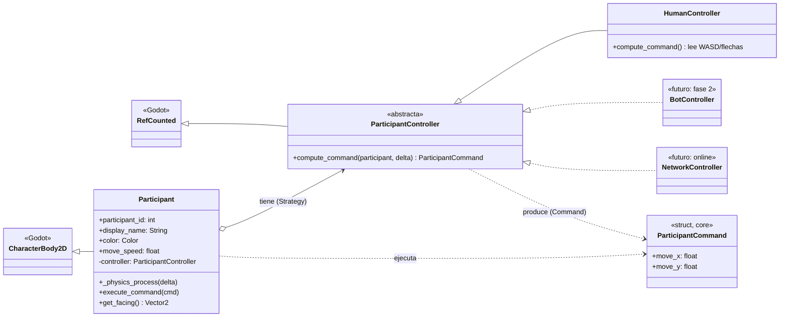
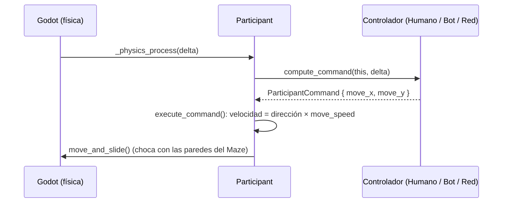

<!-- Sección §5 de docs/ARQUITECTURA.md (índice). -->
# §5. Módulo 2 — Participante (detalle)

### Problema que resuelve el diseño
Un participante puede ser controlado por una persona, un bot o (en el futuro) otro jugador por internet.
Si el participante leyera el teclado directamente, habría que reescribirlo para cada caso.

### Solución: Strategy + Command

Cada frame:

| Pieza | Patrón | Por qué |
|---|---|---|
| `ParticipantController` → `HumanController` | **Strategy** | Cambiar quién controla sin tocar `Participant`. Los bots (fase 2) serán otra estrategia. |
| `ParticipantCommand` | **Command** | La orden es un dato: se puede mandar por red, grabar para repeticiones o generar por la IA. |
| `Participant` + escena con `View` | **Composición** y separación lógica/visual | La lógica (C++) no dibuja; la vista (`participant_view.gd`) no decide. Cambiar el arte no toca la lógica. |
| Herencia | Corta, solo donde hay "es un" real | `HumanController` *es un* controlador. El resto se compone. |

### Archivos
| Archivo | Qué es |
|---|---|
| `src/core/participant_command.h` | La orden (Command), dato puro |
| `src/game/participant_controller.{h,cpp}` | `ParticipantController` (base, registrada como abstracta) y `HumanController` |
| `src/game/participant.{h,cpp}` | `Participant` (`CharacterBody2D`, movimiento flotante top-down) |
| `project/scenes/participant/participant.tscn` | Escena: cuerpo + colisión circular (r = 11 px) + vista |
| `project/scripts/participant/participant_view.gd` | Vista provisional (círculo + dirección) |
| `project/scenes/sandbox/participant_sandbox.tscn` | Prueba: laberinto + participante + cámara que lo sigue |

Controles (acciones del InputMap en `project.godot`): `move_left/right/up/down` = WASD y flechas.

### Decisiones y pendientes
- La velocidad viene del componente `Stats` (ver §6).
- **`ParticipantController` hereda de `RefCounted`** (no de `Node`): no necesita estar en el árbol de escena
  y cada participante tiene su propia instancia.
- **Movimiento libre (no casilla por casilla)** con `motion_mode = floating`: se siente más fluido para persecuciones.
- Verificado: se mueve a `move_speed` px/s y se detiene al chocar con las paredes.
