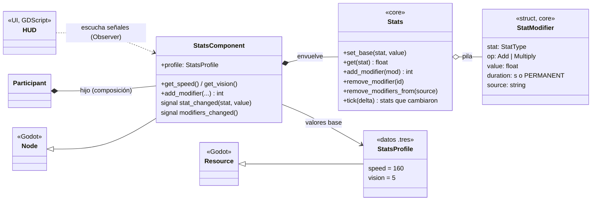

<!-- Sección §6 de docs/ARQUITECTURA.md (índice). -->
# §6. Módulo 3 — Stats (detalle)

### Problema que resuelve el diseño
La velocidad (y luego la visión, resistencia, ataque) cambia por muchas causas a la vez: puntos permanentes,
power-ups temporales, llevar el trofeo. Si cada sistema modificara el número directamente, se pisarían
entre sí y nadie sabría cuál es el valor real ni cómo deshacer un efecto.

### Solución: valor base + pila de modificadores

```
valor final = clamp( (base + Σ sumas) × Π multiplicadores , mínimo, máximo )

ejemplo:  (160 + 10 punto) × 1.5 power-up × 0.6 trofeo = 153 px/s
```

Cada modificador lleva **origen** (`source`) y **duración**. Los temporales vencen solos; los de un origen
se quitan juntos (al soltar el trofeo se quita solo el `×0.6` del trofeo).

> **Sobre el patrón:** es la variante de **Decorator** que se usa en juegos. El Decorator clásico envuelve
> objetos uno dentro de otro; aquí los "envoltorios" son entradas en una lista. Mismo efecto (apilar
> modificaciones sin tocar el valor base), pero más fácil de leer, quitar, serializar y probar.



| Pieza | Patrón | Por qué |
|---|---|---|
| `Stats` + `StatModifier` (core) | **Modificadores (Decorator)** | Apilar y quitar efectos sin tocar el valor base. 6 tests. |
| `StatsComponent` hijo de `Participant` | **Composición** | El participante *tiene* stats; bots y vándalos reutilizarán el mismo componente. |
| `stat_changed` / `modifiers_changed` | **Observer** (señales) | El HUD y la visión reaccionan sin que el componente los conozca. |
| `StatsProfile` (`.tres`) | **Datos fuera del código** | Cada personaje tendrá su perfil; se edita en el inspector de Godot. |

### Archivos
| Archivo | Qué es |
|---|---|
| `src/core/stats.{h,cpp}` | Lógica: base, modificadores, vencimiento, límites |
| `tests/test_stats.cpp` | 6 tests: orden suma→multiplica, por stat, vencimiento, quitar por id/origen, límites |
| `src/game/stats_profile.{h,cpp}` | Recurso con valores base |
| `src/game/stats_component.{h,cpp}` | Nodo componente; constantes `STAT_SPEED`, `STAT_VISION`, `OP_ADD`, `OP_MULTIPLY` |
| `project/data/stats/default_participant.tres` | Perfil por defecto (160 px/s, 5 casillas) |
| ~~`StatsPanel`~~ | Reemplazado por el `HUD` (§10) |

### Decisiones
- **Límites de seguridad:** velocidad 20–600 px/s, visión 1–20 casillas (ningún efecto deja inmóvil o ciego).
- `Participant` busca su `StatsComponent` entre sus hijos al iniciar; sin él no se mueve y avisa con un warning.
- La visión todavía no tiene efecto visible: la usa la pieza 4 (niebla de guerra).
- Verificado en Godot: 160 px/s base → 240 px/s con power-up ×1.5 → vuelve a 160 al vencer.
