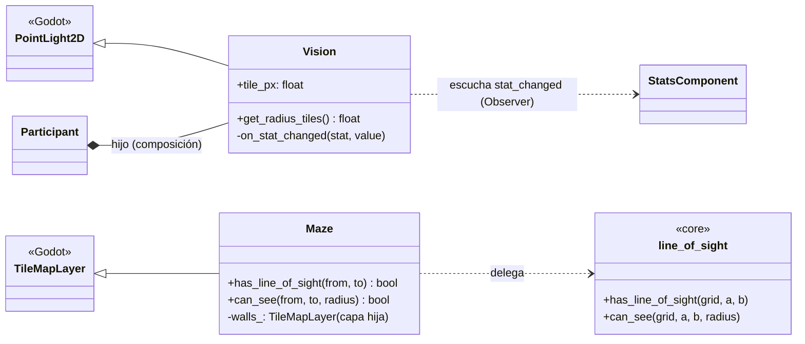

<!-- Sección §7 de docs/ARQUITECTURA.md (índice). -->
# §7. Módulo 4 — Visión limitada (detalle)

### Problema que resuelve el diseño
Dos necesidades distintas que no conviene mezclar:
1. **Lo que ve la persona** en pantalla: oscuridad salvo cerca de su participante, sin ver a través de las paredes.
2. **Lo que "sabe" cada participante** para la lógica: un bot no debe reaccionar a algo que no podría ver (si no, hace trampa).

### Solución: lógica en `core`, efecto visual con las luces 2D de Godot

| Necesidad | Solución | Dónde |
|---|---|---|
| Regla "¿A ve a B?" | Radio + línea de visión sobre la cuadrícula (algoritmo DDA) | `lv::core::can_see` (core, 6 tests) → `Maze.can_see()` |
| Efecto en pantalla | `PointLight2D` con sombras + `CanvasModulate` oscuro en el nivel | `Vision` (hijo del participante) |
| Paredes que tapan | Oclusores en la casilla de pared del TileSet | `Maze` |
| Ver las paredes cercanas pero no lo de detrás | Paredes en una capa hija con su propia máscara de luz: la luz las ilumina pero no las sombrea | `Maze` (capa `Walls`, `WALLS_LIGHT_MASK = 2`) |

| Pieza | Patrón | Por qué |
|---|---|---|
| `Vision` hijo de `Participant` | **Composición** | Se agrega o quita sin tocar al participante. Los bots no la necesitan. |
| `Vision` escucha `stat_changed` | **Observer** | El power-up de visión agranda el radio solo (con transición suave). |
| `line_of_sight` en `core` | **Lógica separada de la vista** | Regla testeable y reutilizable por la IA; la luz solo es la representación. |

### Archivos
| Archivo | Qué es |
|---|---|
| `src/core/line_of_sight.{h,cpp}` | `has_line_of_sight`, `can_see` (puntos en coordenadas de casilla con decimales) |
| `tests/test_line_of_sight.cpp` | 6 tests: sala abierta, pared bloquea, desde/hacia pared, misma casilla, radio, simetría |
| `src/game/vision.{h,cpp}` | Luz de visión con radio = stat `vision` × tamaño de casilla |
| `src/game/maze.{h,cpp}` | Oclusores, capa `Walls`, `has_line_of_sight`/`can_see` |

### Decisiones
- **Radio en casillas** (stat `vision`, por defecto 5): con pasillos de 3 casillas se ve aproximadamente un tramo y medio.
- **Esquinas diagonales:** si dos paredes se tocan en diagonal, no se ve entre ellas.
- **Solo hay una luz por pantalla:** con varios humanos en la misma máquina (multijugador local) habrá que decidir pantalla dividida u otra solución. Anotado en el ROADMAP.
- Para que haya oscuridad, el nivel debe tener un `CanvasModulate` oscuro (el sandbox lo tiene; tecla **V** lo apaga para depurar).
- Verificado en Godot: radio 5 → 7 con el power-up de visión (+2); `can_see` es falso a través del borde y fuera de radio.
