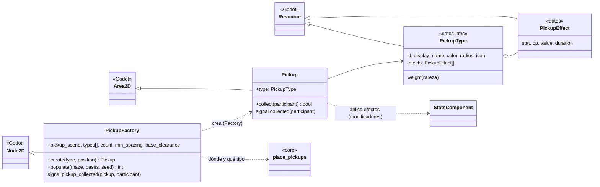

<!-- Sección §8 de docs/ARQUITECTURA.md (índice). -->
# §8. Módulo 5 — Objetos recolectables (detalle)

### Problema que resuelve el diseño
Habrá muchos tipos de objetos (puntos, power-ups, pociones, escudos, bombas...). Si cada tipo se
programara a mano, cada objeto nuevo sería código nuevo, recompilar y riesgo de romper otros.

### Solución: tipos como datos + fábrica

Cada tipo es un archivo `.tres` (`PickupType`) con nombre, color, rareza (`weight`) y una lista de
efectos (`PickupEffect`: stat, sumar/multiplicar, valor, duración). **Agregar un objeto = crear un archivo.**
Los efectos se aplican como modificadores de Stats (§6), así que no hay un segundo sistema de efectos.

| Pieza | Patrón | Por qué |
|---|---|---|
| `PickupType` / `PickupEffect` (`.tres`) | **Datos fuera del código** | Diseñar objetos sin programar; se editan en el inspector. |
| `PickupFactory.create()` | **Factory** | Un solo lugar sabe cómo armar un objeto (escena + tipo + conexiones). |
| `place_pickups` (core) | Lógica pura | Reglas de colocación testeadas: suelo, fuera de bóveda, lejos de bases, separación, rareza. |
| `collected` → `pickup_collected` | **Observer** | La interfaz (y luego el Director de IA) se entera sin que el objeto la conozca. La fábrica reenvía las señales para conectarse una sola vez. |
| Efectos = modificadores | Reutiliza **Decorator** (§6) | Un power-up temporal vence solo; un punto es permanente. |

### Aleatoriedad portable (`core/random.h`)
Las distribuciones de la biblioteca estándar de C++ (`uniform_int_distribution`, `shuffle`, etc.) dan
resultados distintos según el compilador. Para que **una semilla produzca el mismo laberinto y los mismos
objetos en Windows, Linux y en red**, todo `core` usa `lv::core::Rng` (mt19937 + funciones propias).
`MazeGrid` también se migró a `Rng` en esta pieza.

### Archivos
| Archivo | Qué es |
|---|---|
| `src/core/random.h` | `Rng`: `range`, `unit`, `chance`, `shuffle`, `weighted` deterministas |
| `src/core/pickup_placer.{h,cpp}` | `place_pickups`: dónde y de qué tipo |
| `tests/test_pickup_placer.cpp` | 8 tests (3 de `Rng`, 5 de colocación) |
| `src/game/pickup_type.{h,cpp}` | `PickupEffect`, `PickupType` |
| `src/game/pickup.{h,cpp}` | `Pickup` (`Area2D`) |
| `src/game/pickup_factory.{h,cpp}` | `PickupFactory` |
| `project/data/pickups/*.tres` | `punto_velocidad` (+8 vel, común), `punto_vision` (+0.5 visión, común), `powerup_rapidez` (×1.5 vel 6 s, raro) |
| `project/scenes/pickups/pickup.tscn` + `scripts/pickups/pickup_view.gd` | Escena y vista provisional (círculo común, rombo raro) |

### Decisiones
- Los objetos se colocan con **la misma semilla que el laberinto**: misma partida = mismos objetos.
- Quedan libres 6 casillas alrededor de cada base y la bóveda completa.
- `Pickup.collect()` es público: la IA o la red podrán recoger sin depender de la física.
- **Visión gratis:** los objetos usan la máscara de luz normal, así que quedan ocultos en la sombra.
- No reaparecen: lo decidirá el Director de IA (fase 5). Anotado en el ROADMAP.
- Verificado en Godot: 30 objetos (14/13/3), ninguno en paredes; recoger aplica +8 y ×1.5 (160 → 168 → 252) y el contador sube.
