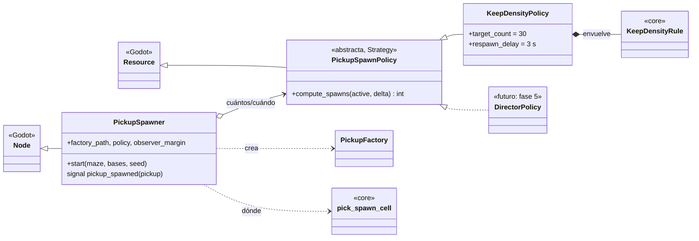

<!-- Sección §9 de docs/ARQUITECTURA.md (índice). -->
# §9. Bloque UX-1 — Objetos infinitos (reaparición)

### Problema que resuelve el diseño
Con objetos fijos, el mapa se vacía y deja de haber motivo para explorar. Además, "cuántos y cuándo
aparecen" es justo lo que el **Director de IA** (fase 5) querrá controlar: no debe quedar fijo en el código.

### Solución: separar CUÁNTOS/CUÁNDO, DÓNDE y CÓMO

| Pregunta | Responde | Patrón |
|---|---|---|
| ¿Cuántos y cuándo? | `PickupSpawnPolicy` (hoy `KeepDensityPolicy`: mantener 30, uno cada 3 s) | **Strategy** (y es un `Resource`: se elige y ajusta en el inspector) |
| ¿Dónde? | `lv::core::pick_spawn_cell`: suelo, fuera de bóveda, lejos de bases y de otros objetos, **fuera de la vista de todos los participantes** | Lógica pura (tests) |
| ¿Cómo se crea? | `PickupFactory.create()` (§8) | **Factory** |
| ¿Quién se entera? | Señal `pickup_spawned` | **Observer** |

### Archivos
| Archivo | Qué es |
|---|---|
| `src/core/pickup_spawning.{h,cpp}` | `pick_spawn_cell`, `SpawnObserver`, `KeepDensityRule` |
| `tests/test_pickup_spawning.cpp` | 7 tests: restricciones y fuera de vista, determinismo, sin lugar, reglas de densidad |
| `src/game/pickup_spawn_policy.h` | `PickupSpawnPolicy` (abstracta) y `KeepDensityPolicy` |
| `src/game/pickup_spawner.{h,cpp}` | `PickupSpawner` |
| `project/data/spawning/keep_density_default.tres` | Política por defecto (30 objetos, 3 s) |

### Decisiones
- **Nunca aparece nada frente a un participante:** se descarta cualquier casilla que un participante pueda ver
  (radio de visión + 2 casillas de margen, respetando paredes). Los participantes se encuentran por el grupo `participants`.
- Semilla derivada de la del laberinto: misma partida = mismas reapariciones (repeticiones, red).
- La política es `local_to_scene`: cada spawner tiene su propio reloj aunque compartan el archivo.
- Los objetos aparecen con una animación de rebote (vista).
- Verificado en Godot: 30 → recoger 10 → 20 → +1 cada 3 s → vuelve a 30 y se mantiene; 0 reapariciones a la vista del jugador.
