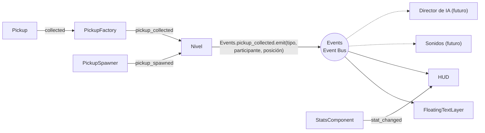

<!-- Sección §10 de docs/ARQUITECTURA.md (índice). -->
# §10. Bloque UX-2 — HUD limpio y textos flotantes

### Problema que resuelve el diseño
La información tapaba el juego (panel y ayuda encima) y las acciones casi no se notaban. Además, si cada
pieza de interfaz se conectara directamente a cada objeto/participante/sistema, todo quedaría enredado.

### Solución
- **El centro de la pantalla siempre libre**: barra superior delgada y semitransparente; ayuda escondida en **F1**.
- **Respuesta inmediata ("game feel")**: textos flotantes, números que cuentan y destellan, fichas de efecto con temporizador.
- **Event Bus** (`Events`, autoload): los niveles publican eventos de juego; la interfaz escucha ahí.

| Pieza | Patrón | Por qué |
|---|---|---|
| `Events` (autoload `scripts/autoload/events.gd`) | **Event Bus** | Productores y consumidores no se conocen. Agregar sonidos o el Director = escuchar el mismo evento. Regla: solo eventos ya ocurridos (en pasado), nada de órdenes. |
| `FloatingTextLayer` | **Object Pool** | 20 etiquetas creadas una vez y reutilizadas; si se llenan, recicla la más antigua. Sin tirones con muchos textos. |
| `HUD` | **Observer** | Solo muestra; escucha `StatsComponent.stat_changed` y `Events`. Nunca modifica el juego. |
| `EffectText` | Texto a partir de los datos | `+8 VEL`, `×1.5 VEL`, `¡RAPIDEZ! ×1.5 VEL` salen de los `PickupEffect`; un objeto nuevo no requiere programar su texto. |

### Detalles de diseño de interfaz
- **Barra superior** (38 px): color del jugador · `VEL` · `VIS` · fichas de efectos **temporales** (los permanentes ya
  se ven en el valor) · `OBJ` a la derecha (el reloj de partida irá ahí en la pieza 7).
- **Números que cuentan** (0,35 s), destello verde si sube o rojo si baja, y un pequeño "pop" de escala.
- **Fichas de efecto**: entran con destello, la barra se vacía según el tiempo restante y salen desvaneciéndose.
- **Textos flotantes**: en pantalla (no en el mundo) para que se vean nítidos con cualquier zoom y no los oscurezca la
  niebla; siguen el punto del mundo donde ocurrió el evento, suben frenando y se desvanecen. Los destacados
  (con `popup_title`) son más grandes y rebotan.
- **F1**: panel de controles centrado (el único elemento que tapa el centro, y solo cuando se pide). La pista
  "F1 · controles" se desvanece a los 5 s. Cada escena define su propio texto de controles.
- Estilos neutros provisionales: el bloque 3 (identidad visual) los reemplaza con un Theme.

### Archivos
| Archivo | Qué es |
|---|---|
| `project/scripts/autoload/events.gd` | Event Bus (`Events`) |
| `project/scripts/ui/effect_text.gd` | `EffectText`: formato de efectos y colores por stat |
| `project/scripts/ui/floating_text_layer.gd` | `FloatingTextLayer` con pool |
| `project/scenes/ui/hud.tscn` + `scripts/ui/hud.gd` | `HUD` (reemplaza al antiguo `StatsPanel`) |
| `src/game/pickup_type.*` | Nuevo `popup_title` (título del texto flotante) |
| `src/game/stats_component.cpp` | `get_modifiers()` incluye `duration` (para la barra de las fichas) |

### Decisiones
- La lógica C++ no conoce la interfaz: los niveles (GDScript) publican en `Events`.
- Verificado en Godot: textos correctos para los 3 tipos; HUD `VEL 252 · VIS 5.5 · OBJ 3`; ficha aparece y desaparece al
  vencer (6 s); 60 textos seguidos usan solo 20 etiquetas; F1 abre el panel; captura con el centro libre.
