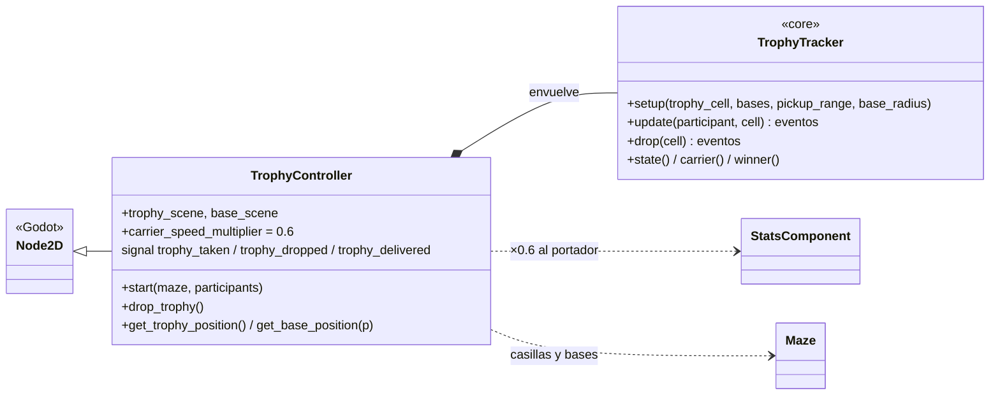

<!-- Sección §11 de docs/ARQUITECTURA.md (índice). -->
# §11. Etapa 1.1 — Trofeo y bases

### Problema que resuelve el diseño
Es el corazón del juego (VISION §3, §6): tomar el trofeo en la bóveda, ir más lento con él y llevarlo a la
base propia. Las reglas tienen que ser exactas y probadas, y no depender de cómo se ve ni de dónde esté la
bóveda (que en la etapa 2.2 será un mini-mapa propio, ver DISENO_MAPA §3).

### Solución: máquina de estados en `core` + controlador que la conecta con Godot

```mermaid
stateDiagram-v2
    [*] --> EnBoveda
    EnBoveda --> Llevado : un participante llega a su lado
    Llevado --> EnElPiso : se suelta (muerte en etapa 4, o tecla T)
    EnElPiso --> Llevado : cualquiera llega a su lado
    Llevado --> Llevado : otro TOCA al portador (robo; inmune 3 s)
    Llevado --> Entregado : el portador llega a SU base
    Entregado --> [*] : hay ganador; no hay más cambios
```

| Pieza | Patrón | Por qué |
|---|---|---|
| `lv::core::TrophyTracker` | **State** (enum: 4 estados sin comportamiento propio) | Reglas exactas y testeadas: solo un portador, solo se entrega en la base propia, tras la entrega no cambia nada. |
| `TrophyController` (`Node2D`) | Adaptador + **Observer** | Pasa casillas al tracker y emite `trophy_taken` / `trophy_dropped` / `trophy_delivered`. |
| Lentitud del portador | Reutiliza **modificadores** (§6) | `×0.6` con origen `"trophy"`; se quita al soltar o entregar y pasa al ladrón en un robo. |
| Robo por contacto (v0.0.18) | Regla en core (`steal`, `can_steal`, `tick`) + detección en el controlador | El tracker decide si se puede (portador distinto, sin inmunidad); el controlador decide qué es "tocar" (cuerpos superpuestos + `steal_margin`). El combate agregará otras formas sin cambiar la regla. |
| Vistas del trofeo y bases | **Factory** con escenas (como `PickupFactory`) | El controlador instancia `trophy_scene` y `base_scene` y les pasa datos (`color`, `size_px`, `carried`); no dibuja. |
| `ObjectiveIndicator` (HUD) | Vista | Flecha al objetivo (trofeo, o tu base si lo llevas) con distancia en casillas. |

### Archivos
| Archivo | Qué es |
|---|---|
| `src/core/trophy_tracker.{h,cpp}` | Reglas y estados del trofeo |
| `tests/test_trophy_tracker.cpp` | 9 tests: tomar de cerca/lejos, un solo portador, solo base propia, base sin trofeo, soltar y retomar, soltar sin portador, cierre tras entrega, inválidos |
| `src/game/trophy_controller.{h,cpp}` | `TrophyController` |
| `project/scenes/trophy/trophy.tscn` + `scripts/trophy/trophy_view.gd` | Copa dorada con luz propia (se ve en la oscuridad) |
| `project/scenes/trophy/base.tscn` + `scripts/trophy/base_view.gd` | Zona de resguardo del color del dueño, con luz tenue |
| `project/scripts/ui/objective_indicator.gd` | Flecha de objetivo en el borde de la pantalla |
| `project/scripts/autoload/events.gd` | Nuevos eventos `trophy_taken`, `trophy_dropped`, `trophy_delivered` |

### Decisiones
- Participante `i` ↔ base `i` de `Maze.get_base_zones(n)` (esquinas primero). La zona mide lo que el pasillo (§18).
- **Robo (v0.0.18):** quien toca al portador le quita el trofeo. Inmunidad de `steal_immunity` (3 s) al tomarlo y al
  robarlo, para que no cambie de mano en cada frame. Evento `trophy_stolen(thief, victim)`. Los bots tienen la acción
  `StealTrophyAction` (persiguen al portador). 3 tests en core + 1 de bots.
- **Anti-bucle (v0.0.19):** el robo instantáneo + portador lento + todos persiguiendo hacía que el trofeo cambiara de
  mano sin parar. Se combinan tres soluciones:
  1. **Reglas como datos** (`TrophyRules`, `data/trophy/default_rules.tres`): impulso al ladrón (×1,5 por 2 s) y
     aturdimiento a la víctima (×0,2 por 1 s), con **modificadores temporales** de Stats (orígenes `steal_boost` y
     `steal_stun`). Valen igual para humanos y bots.
  2. **Fichas de ataque** (`lv::core::TokenPool`, §19): solo `max_chasers` (2) bots persiguen al portador.
  3. **Emboscada** (`AmbushAction`, §19): los demás esperan 2 celdas antes de la base del portador.
- **Atrapar al portador (v0.0.20, modo por defecto):** el traspaso seguía en bucle. Ahora `TrophyRules.steal_mode`
  elige la regla (**Strategy por datos**): `Transferir` (lo anterior) o `Eliminar al portador` (VISION §16: "si muere
  con el trofeo, cae al piso"; "al morir se reaparece en la base"). Al tocar al portador:
  el trofeo cae al piso (nadie lo toma por `drop_lock` = 0,5 s) y el portador queda **eliminado**: desaparece,
  reaparece en su base a los 3 s y queda **protegido** 2 s (parpadea). Portador a ×0,85; inmunidad al recoger: 2 s.
  Quien pierde el trofeo queda lejos y fuera un rato: el grupo alrededor del trofeo se vacía solo.

  | Pieza | Patrón | Por qué |
  |---|---|---|
  | `lv::core::LifeCycle` | **State** (Vivo → Eliminado → Protegido → Vivo) | Es la base de la "reaparición" de la Etapa 4: luego se le suman salud y vidas. 4 tests. |
  | `LifeComponent` (hijo del participante) | **Composición** (como `StatsComponent`) | El participante no se mueve ni colisiona mientras está eliminado; la vista se oculta y parpadea al volver. |
  | `ParticipantController.on_respawned` | Gancho del **Strategy** | El bot descarta su camino viejo; los pedidos de camino llevan "generación" para ignorar los de antes de morir. |
  | `Events.participant_eliminated / participant_respawned` | **Event Bus** | Avisos del HUD; luego sonidos y Director. |
- Se toma el trofeo a 1 casilla de distancia (Chebyshev).
- **El trofeo tiene luz propia**: es "visible para todos" (VISION §6) aunque esté lejos o en la oscuridad.
- Mientras no exista la pieza "Partida", el sandbox muestra el cartel de victoria con el tiempo y detiene al ganador.
- Verificado en Godot: base sin trofeo → nada; tomar → 160 → 96 px/s, aviso y flecha a "TU BASE"; soltar → 160 y se
  retoma al pasar; entregar → cartel "¡VICTORIA!", velocidad normal, jugador quieto. Capturas con base, flecha y trofeo.
