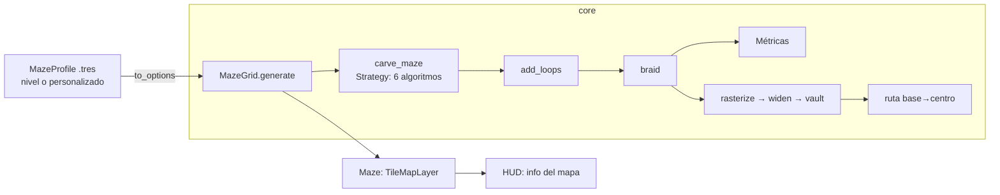

<!-- Sección §12 de docs/ARQUITECTURA.md (índice). -->
# §12. Etapa 2.1 (parte) — Algoritmos de generación y dificultad

### Problema que resuelve el diseño
Un solo algoritmo produce siempre laberintos del mismo "estilo". Queremos mapas variados y **dificultades
medibles**, usando algoritmos clásicos y probados en lugar de inventar uno.

### Solución
1. **Topología separada del dibujo**: `PassageGrid` (celdas + pasajes abiertos) es el grafo del laberinto; `MazeGrid`
   lo "dibuja" en casillas. Es el primer paso hacia mapas de otras formas (DISENO_MAPA §2).
2. **6 algoritmos clásicos** intercambiables (**Strategy**, elegido por dato):

| Algoritmo | Personalidad | Callejones (aprox.) |
|---|---|---|
| Backtracking recursivo | Pasillos muy largos y sinuosos | ~10 % |
| Hunt-and-Kill | Parecido, algo más ramificado | ~10 % |
| Growing Tree | Mezcla configurable (`bias`: 1 = backtracking, 0 = Prim) | variable |
| Kruskal | Uniforme, muchos cruces | ~30 % |
| Wilson | Uniforme **sin sesgo** (todos los laberintos igual de probables) | ~30 % |
| Prim | Muy ramificado, callejones cortos: confunde | ~35 % |

3. **Post-procesos**: `add_loops` (rutas alternativas al azar) y `braid` (elimina callejones sin salida, uniendo
   preferentemente dos callejones con un solo pasaje).
4. **Métricas** (`MazeGrid::Metrics`): celdas, callejones, cruces, % de callejones y **largo de la ruta** base → centro.
5. **Niveles predefinidos** (`maze_preset`, fuente única de sus valores) y **perfiles como datos** (`MazeProfile` .tres):

| Nivel | Algoritmo | Celdas | Pasillo | Bucles | Braid | Medido (20 semillas): callejones / ruta |
|---|---|---|---|---|---|---|
| Fácil | Hunt-and-Kill | 16×11 | 3 | 15 % | 60 % | 3 % / 46 |
| Normal | Growing Tree (0.5) | 20×14 | 3 | 8 % | 25 % | 12 % / 66 |
| Difícil | Wilson | 26×18 | 3 | 3 % | 5 % | 25 % / 101 |
| Extremo | Prim | 32×22 | 2 | 0 % | 0 % | 35 % / 87 (ruta más corta, pero muy ramificada) |

### Archivos
| Archivo | Qué es |
|---|---|
| `src/core/maze_algorithms.{h,cpp}` | `PassageGrid`, `MazeAlgorithm`, `carve_maze`, `add_loops`, `braid` |
| `src/core/maze_grid.{h,cpp}` | Generación por pasos, `Metrics`, `path_length`, `MazeDifficulty`, `maze_preset` |
| `tests/test_maze_algorithms.cpp` | 6 tests: árbol conectado por algoritmo, determinismo, personalidades, braid 100 %, niveles conectados, **niveles ordenados por dificultad** |
| `src/game/maze_profile.{h,cpp}` | `MazeProfile` (Resource): nivel o personalizado; en el inspector solo se ven los campos personalizados si corresponde |
| `project/data/maps/{facil,normal,dificil,extremo}.tres` | Perfiles de los 4 niveles |

### Decisiones
- Cantidad de objetos proporcional al tamaño (~1 cada 9 celdas) en los niveles; fija en "Personalizado".
- El backtracking es el Growing Tree con `bias = 1` (un solo código para ambos).
- Todos los algoritmos usan `Rng` (portables y deterministas).
- Verificado en Godot: los 4 niveles generan, se juegan y se distinguen a simple vista (capturas); tecla **M** cambia el nivel.
