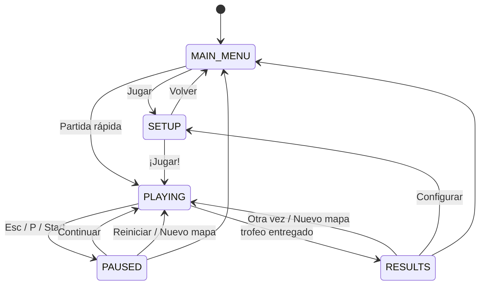

<!-- Sección §13 de docs/ARQUITECTURA.md (índice). -->
# §13. Etapa 1.3 — Menús, flujo del juego y opciones

### Problema que resuelve el diseño
El juego se controlaba con teclas de prueba y no tenía principio ni fin. Hacía falta: menú principal, configurar la
partida (incluida la generación del mapa), pausa, resultados y opciones, todo con **mouse** (y teclado/mando).

### Solución

| Pieza | Patrón | Por qué |
|---|---|---|
| `App` (autoload) | **State** (flujo del juego) | Un solo lugar decide las transiciones (con fundido). Las pantallas no se conocen entre sí: piden a `App`. |
| `Settings` (autoload) | Configuración persistente + **Observer** (`changed`) | Se guarda en `user://settings.cfg` y se aplica sola; la partida reacciona al cambiar el zoom o las teclas de prueba. |
| `MatchConfig` (Resource) | Objeto de configuración | Lo que el menú elige (perfil + semilla) y la partida lee. |
| `Maze.build_preview()` (C++, estático) | Consulta sin efectos | Genera la imagen del laberinto sin crear el nivel: vista previa instantánea. |
| `ui/theme.tres` | Tema único | Todos los botones, paneles y campos comparten estilo; cambiar la estética = editar un archivo. |
| Pausa y resultados | Capas (`CanvasLayer`) con `process_mode = ALWAYS` | Funcionan con el árbol en pausa y no reemplazan la partida. |

### Pantallas
| Escena | Qué hace |
|---|---|
| `scenes/menus/main_menu.tscn` | Título, Jugar, Partida rápida, Opciones, Salir. Fondo: laberinto real que se desplaza. |
| `scenes/menus/match_setup.tscn` | Dificultad (5 botones), controles personalizados generados desde una tabla (algoritmo, tamaño, pasillo, atajos, callejones, bóveda, objetos), semilla, **vista previa en vivo** con métricas. **El mapa de la vista previa es el que se juega.** |
| `scenes/menus/settings_menu.tscn` | Pantalla completa, VSync, mostrar FPS, teclas de prueba, zoom de cámara. Reutilizado desde el menú y desde la pausa. |
| `scenes/menus/pause_menu.tscn` | Continuar, Reiniciar (mismo mapa), Nuevo mapa, Opciones, Menú principal, Salir. |
| `scenes/menus/results_screen.tscn` | Resultado con tiempo, objetos, mapa y semilla; Otra vez, Nuevo mapa, Configurar, Menú. |
| `scenes/game/match.tscn` | La partida (antes era la escena de prueba). Lee `App.match_config`. |

### Decisiones
- **Semillas:** la partida guarda la semilla real del mapa; "Reiniciar"/"Otra vez" repiten ese mapa, "Nuevo mapa" pone 0 (aleatoria).
- **Teclas de prueba** (1/2/3/0/T/V/Tab) solo si se activan en Opciones; la ayuda F1 se adapta.
- Acción `pause` en el InputMap: Esc, P y botón Start del mando.
- Verificado en Godot (prueba automática pulsando botones): menú → configurar (Difícil, vista previa) → partida con **la misma semilla** de la vista previa → pausa (árbol pausado) → continuar → victoria → resultados → nuevo mapa (semilla distinta). Capturas de cada pantalla.
