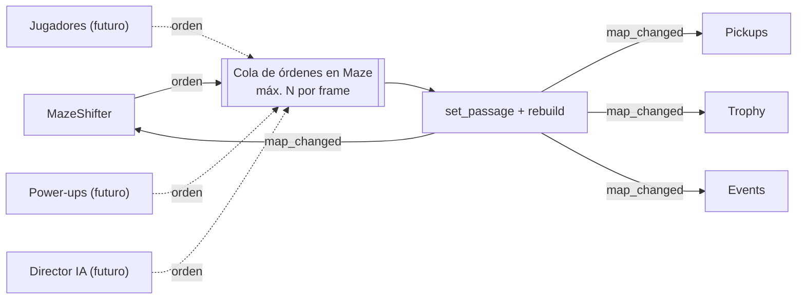

<!-- Sección §16 de docs/ARQUITECTURA.md (índice). -->
# §16. Rendimiento: medición y cola de cambios del mapa

Detalle de presupuestos, cómo medir y reglas: [`RENDIMIENTO.md`](../RENDIMIENTO.md).

### Problema
Tirones al aplicarse cambios del laberinto vivo, sobre todo en mapas grandes. Y en el futuro habrá más fuentes de
cambios a la vez (jugadores, power-ups, Director de IA). Hacía falta **ver** qué cuesta y **escalar** por diseño.

### Solución

| Pieza | Patrón / técnica | Por qué |
|---|---|---|
| `lv::core::Perf` + `PerfScope` | Instrumentación RAII | Medir cada sistema con una línea; ventanas de 1 s (total, peor, llamadas). |
| `PerfStats` (C++ estático) + panel **F3** (`Perf`, autoload) | Observabilidad | Ver en vivo el peor frame y el costo de cada sistema; monitores en el depurador de Godot. |
| Cola en `Maze` (`queue_passage_change`) | **Command** + presupuesto por frame | Cualquier fuente de cambios produce órdenes; nunca más de `changes_per_frame` por frame. Base para red y repeticiones. |
| `PassageGrid::has_alternative_path` | Búsqueda **bidireccional local y acotada** | Antes: revisar el mapa entero por cada cierre. Ahora: explora desde ambos lados y para al encontrarse; tope de 4096 pasos con respuesta conservadora. Test: misma respuesta que la búsqueda completa. |
| Pasajes protegidos | **Caché** (precalculado al generar) | Se consultaba miles de veces creando listas; ahora es O(1). |
| `plan_maze_shift` | **Muestreo** + equilibrio seguro | Costo según cambios pedidos, no según el tamaño del mapa. Si faltan cierres, se descartan aperturas solo si es seguro. |
| `PickupFactory` | **Índice espacial** casilla → objeto | Retirar objetos tapados: O(casillas cambiadas) en lugar de O(objetos). |
| `maze.rebuild` | `update_internals()` medido aparte | Separa el costo propio del de Godot (colisión/sombras) para saber a quién optimizar. |

### Decisiones
- El rescate de participantes ocurre al **aplicarse** el cierre (`map_changed`), no al encolarlo (la cola puede retrasarlo
  1-2 frames; el margen de ocupación de 14 px lo cubre).
- Tests: 62 (2 nuevos: equivalencia de la búsqueda local con la completa y respuesta conservadora con límite).
