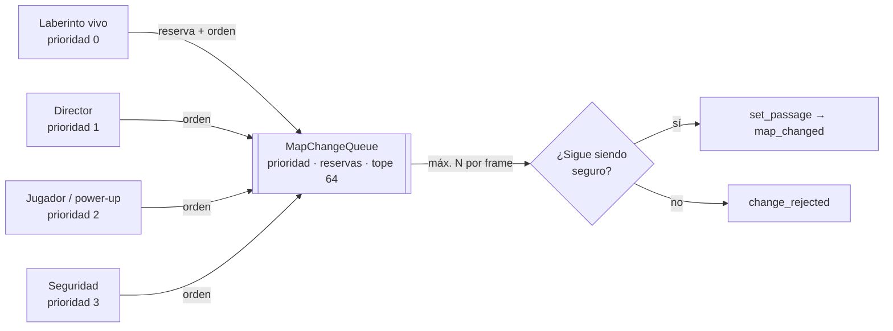

<!-- Sección §17 de docs/ARQUITECTURA.md (índice). -->
# §17. Escalabilidad: prioridades y reservas, índice de entidades y prueba de estrés

### Problema
En el futuro varias fuentes cambiarán el mapa a la vez (laberinto vivo, jugadores, power-ups, Director) y habrá
decenas de entidades moviéndose. Hacía falta: reglas cuando dos fuentes chocan, consultas "¿quién está cerca?"
baratas, y una forma reproducible de medir el peor caso.

### Solución

| Pieza | Patrón / técnica | Qué resuelve |
|---|---|---|
| `lv::core::MapChangeQueue` | **Command** + cola de **prioridad** + **reservas** + tope | Prioridad: seguridad > jugador > Director > automático. Un cambio anunciado **reserva** su pasaje; solo alguien más prioritario puede tomarlo (y el anterior cede). Una orden por pasaje (gana la más prioritaria). Tope 64: se descarta la menos prioritaria. FIFO dentro de cada prioridad. 5 tests. |
| Validación al aplicar (`Maze._process`) | Verificar en el último momento | Cada orden se valida contra el mapa **actual** (`can_close/open_passage`); si ya no es segura se descarta (`change_rejected`). |
| `MazeShifter` con reservas | Cooperación entre fuentes | Reserva durante el aviso; si una fuente más prioritaria toma el pasaje, cede ese cambio. |
| `lv::core::SpatialHash` + `EntityIndex` | **Índice espacial** (cubetas) | "¿Quién está cerca?" revisando solo las cubetas que toca el círculo. Sigue al grupo `participants` (luego bots, vándalos). El laberinto vivo lo usa para la ocupación. 2 tests (igual a fuerza bruta). |
| `WanderController` | **Strategy** (otra más) | Entidades que deambulan: carga para la prueba de estrés y anticipo de los bots. |
| Prueba de estrés (`scripts/game/stress_test.gd`, menú principal) | Benchmark reproducible | Peor caso de referencia + 40 entidades + ráfagas de "jugador" y "Director" compitiendo. Informe: promedio, p95, p99, peor, sistemas más caros, órdenes descartadas y veredicto contra el presupuesto. |

### Archivos
| Archivo | Qué es |
|---|---|
| `src/core/map_change_queue.{h,cpp}` | Cola con prioridades, reservas y tope |
| `src/core/spatial_hash.{h,cpp}` | Índice espacial por cubetas |
| `tests/test_scalability.cpp` | 7 tests (cola y índice) |
| `src/game/entity_index.{h,cpp}` | `EntityIndex` (nodo; `EntityIndex.find(tree)`) |
| `src/game/participant_controller.*` | `WanderController` |
| `src/game/maze.*` | Cola nueva, reservas, validación al aplicar, `request_random_shift`, constantes `PRIORITY_*` |
| `project/scripts/game/stress_test.gd` | Prueba de estrés e informe |
