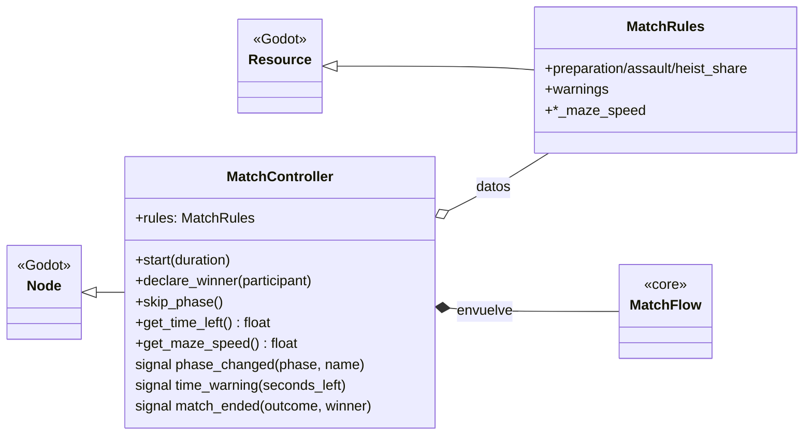

<!-- Sección §18 de docs/ARQUITECTURA.md (índice). -->
# §18. Etapa 1.2 — Partida: reloj, fases y fin por tiempo

### Problema que resuelve el diseño
La partida solo terminaba al ganar. La VISION pide un reloj (≈ 8 min), tres fases (Preparación → Asalto →
Golpe de los vándalos) y, si se acaba el tiempo, **nadie gana**. Hacerlo con `if _elapsed > 180` en `match.gd` no
se puede probar sin Godot y se rompe cuando vándalos y Director necesiten saber en qué fase estamos.

### Solución: máquina de fases pura que devuelve eventos
`MatchFlow::advance(dt)` avanza el reloj y devuelve **todos** los eventos de ese tramo en orden (avisos, cambios
de fase, fin): un frame largo que cruza dos fases no pierde ninguno. El nodo los traduce a señales y la escena
los publica en el Event Bus. Las fases se reparten por porcentaje (40/35/25 por defecto, se normalizan).

| Pieza | Patrón | Por qué |
|---|---|---|
| `lv::core::MatchFlow` | **State** (enum + tabla de tiempos) | Una fase activa, transiciones claras y un único fin. Enum porque las fases aún no tienen comportamiento propio; si lo tienen (vándalos por fase), se separan en clases. |
| `MatchController` | Adaptador + **Observer** | Traduce eventos a señales; no conoce laberinto, trofeo ni interfaz. Quién ganó se lo dicen (`declare_winner`). |
| `MatchRules` (.tres) | **Datos** | Parte de cada fase, avisos y ritmo del laberinto vivo por fase sin recompilar. La duración la elige el jugador (`MatchConfig.duration_minutes`). |
| `Events.match_*` | **Event Bus** | Reloj, carteles y (luego) vándalos/Director reaccionan sin acoplarse. |

**Empate** victoria/tiempo en el mismo frame: `MatchController` procesa con `process_physics_priority = 100`,
después del trofeo; la entrega llega primero y gana. Lo cubre un test en core.
**Sin límite** (`duration <= 0`): las fases avanzan con 8 min de referencia, el Golpe no termina y no hay avisos.

### Zonas de resguardo ajustadas al pasillo (arreglo en esta etapa)
La base era un cuadro fijo de 3×3 casillas alrededor de una casilla: con pasillos de 1–2 casillas se metía en
las paredes, con 4–5 quedaba chica y con anchos pares se descentraba. Ahora la base es **el cuadro de pasillo
completo de su celda** (`MazeGrid::base_zones` → `TileRect` de `corridor_width × corridor_width`), igual en
reglas (`TrophyTracker` entrega en cualquier casilla de la zona), vista (`base_view` con `size_px` exacto),
vista previa del menú, flecha de objetivo y punto de inicio (centro real de la zona).
El cuerpo del participante también se ajusta (`Participant.body_radius` ≤ 40 % del pasillo): con pasillo de 1
casilla (16 px) el cuerpo normal (22 px) no pasaba. Revisados y sin cambios: objetos (radio ≤ 6,5 px), trofeo
(en la bóveda, ≥ 5×5), margen del laberinto vivo (14 px ≥ radio del cuerpo).

### Archivos
| Archivo | Qué es |
|---|---|
| `src/core/match_flow.{h,cpp}` | Reloj y fases (lógica pura) |
| `tests/test_match_flow.cpp` | 10 tests: límites exactos, frame largo, avisos una vez, victoria en cada fase, nada tras el fin, empate, sin límite, saltar fase, normalización |
| `src/game/match_controller.{h,cpp}` | `MatchRules` (recurso) y `MatchController` (nodo) |
| `project/data/match/default_rules.tres` | 40/35/25, avisos a 60 y 10 s, laberinto ×2 en el Golpe |
| `src/core/cell.h` (`TileRect`), `maze_grid.*` (`base_zones`), `trophy_tracker.*` | Zonas de base; 2 tests nuevos |
| `src/game/maze.*` (`get_base_zones`, `tile_rect_to_world`), `trophy_controller.*`, `participant.*` (`body_radius`) | Adaptación al ancho de pasillo |
| `project/scripts/ui/hud.gd` + `hud.tscn` | Reloj arriba al centro (rojo en el último minuto, late en los últimos 10 s), avisos de fase y tiempo |
| `project/scripts/game/match.gd`, `match_config.gd`, `menus/match_setup.gd` | Integración, resultados "TIEMPO AGOTADO", duración en el menú (5/8/12/20 min, sin límite, personalizada 1–60) |

### Decisiones
- Fases: Preparación 40 %, Asalto 35 %, Golpe 25 % (VISION §18 lo dejaba abierto). Ajustable en el .tres.
- Lo único que cambia hoy por fase es el ritmo del laberinto vivo; vándalos y guardianes por fase llegan en sus etapas.
- La pausa de Godot detiene el reloj (nodo pausable).
- Verificado en Godot: partida de 6 s con pasillo 1 y 4: cambios de fase a 2,4 s y 4,5 s, fin por tiempo con
  pantalla de resultados; zonas 1×1 y 4×4 centradas, cuerpo 6,4 px en pasillo 1. Estrés: 1,27 ms/frame (DENTRO).
