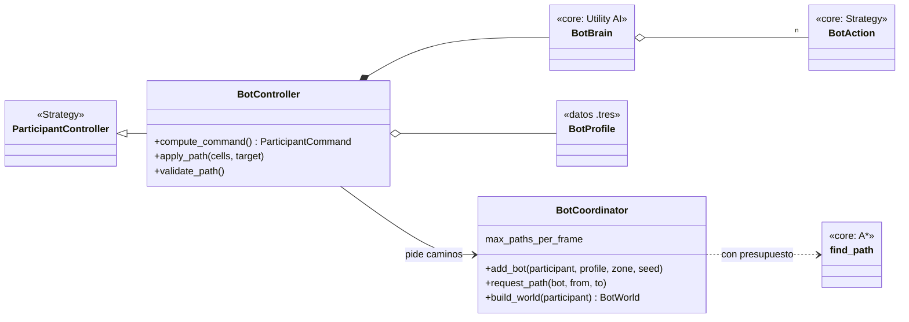

<!-- Sección §19 de docs/ARQUITECTURA.md (índice). -->
# §19. Etapa 3 — Bots con dificultad

### Problema que resuelve el diseño
Hacían falta rivales que busquen el trofeo, lo lleven a su base, se adapten al laberinto vivo y se puedan poner
fáciles o difíciles. Un `if` gigante en el bot obligaría a reescribirlo con cada mecánica nueva (disparar,
portales, power-ups) y repartiría la dificultad por todo el código.

### Solución: tres técnicas clásicas de IA de juegos
1. **A\*** (`lv::core::find_path`) sobre las **celdas lógicas** (no casillas: un Gigante tiene ~17 mil celdas frente
   a cientos de miles de casillas). Entre dos celdas con pasaje abierto, la recta de centro a centro va por suelo.
   Acepta un costo extra por celda: listo para terrenos sin cambiar el algoritmo.
2. **Utility AI** (`lv::core::BotBrain`): cada decisión puntúa todas las acciones (`BotAction`) y elige la mejor.
   Hoy: entregar el trofeo (1,0), ir por el trofeo (0,8), recoger un objeto VISTO (interés × cercanía), explorar (0,1).
   Inercia (+0,05 a lo que ya hacía) y ruido según la dificultad. **Una mecánica nueva = una acción nueva.**
3. **Dificultad como datos** (`BotProfile` .tres): tiempo de reacción, cada cuánto piensa, errores en cruces
   (`choose_next_cell`), interés por objetos y variación ("a veces pro, a veces noob").

| Pieza | Patrón | Por qué |
|---|---|---|
| `BotController` | **Strategy** + **Command** | El participante no sabe que lo controla una IA: recibe órdenes como con el teclado. |
| `BotBrain` + `BotAction` | **Utility AI** (cada acción, un Strategy) | Agregar disparar, portales o power-ups = registrar una acción; el cerebro no cambia. |
| `BotProfile` (.tres × 4) | **Datos** | Dificultades y, luego, personalidades sin código. "Mixto" = un perfil al azar por bot. |
| `BotCoordinator` | **Factory** + cola con presupuesto + **Observer** | Crea bots; calcula ≤ 2 caminos por frame; ante `map_changed` (cierres) cada bot revisa su camino. |
| `TokenPool` (v0.0.19) | **Fichas de ataque** (técnica de juegos de acción) | Solo los N más cercanos persiguen al portador (con inercia para que la ficha no salte). Genérico: luego vándalos y guardianes. Se reparte cada 0,25 s. |
| `StealTrophyAction` / `AmbushAction` | **Utility AI** (acciones nuevas) | Con ficha: persigue. Sin ficha: espera en el camino a la base del portador (punto calculado con A* y cacheado; se borra si el mapa cambia). |
| Percepción (`build_world`) | Juego limpio | El trofeo se ve siempre (tiene luz); los objetos, solo con línea de visión y el radio de su stat. |

**Movimiento:** sigue los centros de celda; si ya está dentro del "carril" no retrocede al centro de la celda
actual; no se pasa del punto (frena al llegar). **Trabado** 1 s sin acercarse → replantea. **Sin ruta** → reintenta
a los 0,5 s. Un pedido de camino viejo (el objetivo cambió mientras esperaba) se descarta.
**Física:** participantes en la capa 2 ("participantes"), chocan solo con la capa 1 ("paredes"): se atraviesan entre
sí hasta la etapa de combate. Los objetos detectan la capa 2. Los bots no tienen luz propia (no te iluminan el mapa).

### Archivos
| Archivo | Qué es |
|---|---|
| `src/core/nav_path.{h,cpp}` | A* con costos y "error en un cruce" |
| `src/core/bot_brain.{h,cpp}` | `BotTuning`, `BotWorld`, `BotAction` (4 acciones), `BotBrain` |
| `src/core/maze_grid.*` | `cell_index_of` (casilla → celda lógica) |
| `tests/test_bots.cpp` | 13 tests: camino más corto, paredes, costos, laberinto real, errores 0 %/100 %, decisiones, reacción, objetos vistos, variación reproducible, acciones nuevas |
| `src/game/bot_controller.{h,cpp}` | `BotProfile` (recurso) y `BotController` |
| `src/game/bot_coordinator.{h,cpp}` | Cola de caminos, percepción, aviso de cambios del mapa |
| `project/data/bots/*.tres` | Fácil, Normal, Difícil, Experto |
| `project/scripts/game/match.gd`, `match_config.gd`, `menus/match_setup.gd` | Rivales 0–7 y dificultad en el menú, creación de bots, resultado "DERROTA" |

### Decisiones
- Sin choques entre participantes ni robo del trofeo hasta la etapa de combate (hoy es una carrera).
- Los bots no usan la flecha ni el HUD: leen el mundo con `build_world`.
- Pendiente: personalidades (pesos por acción en el .tres), árboles de comportamiento para vándalos/guardianes.
