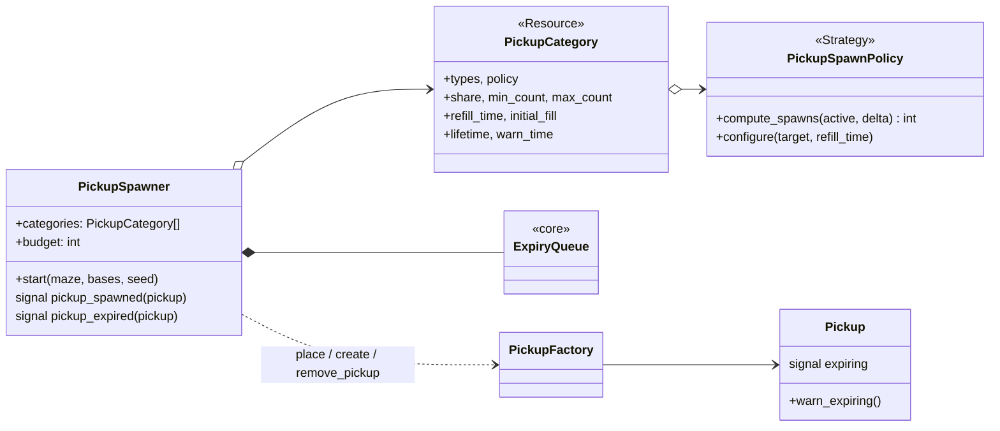

<!-- Sección §20 de docs/ARQUITECTURA.md (índice). -->
# §20. Economía de objetos: categorías, caducidad y topes

### Problema que resuelve el diseño
Los objetos daban demasiado: un solo cupo de 30 para todos los tipos, reposición cada 3 s, objetos que
nunca desaparecían y mejoras permanentes sin techo real (velocidad hasta 600 partiendo de 120). Además,
con un solo cupo no se puede decir "pocas armas y algunos puntos": cada tipo nuevo le quitaría lugar a otro.

### Solución: categorías como datos + cola de caducidad + tope de mejoras

| Pregunta | Responde | Patrón |
|---|---|---|
| ¿Cuántos de cada clase? | `PickupCategory` (.tres): cupo = presupuesto del mapa × `share`, entre `min_count` y `max_count` (`lv::core::category_target`) | Datos fuera del código |
| ¿Cuándo aparecen? | La `policy` de cada categoría (`KeepDensityPolicy`), configurada con `refill_time`: reponer el cupo entero en N s (`lv::core::refill_delay`) | **Strategy** |
| ¿Cuánto duran en el piso? | `lv::core::ExpiryQueue`: aviso (parpadeo) y caducidad; O(eventos que vencen) por frame | Cola de prioridad |
| ¿Cuánto pueden mejorar las stats? | `Stats::set_bonus_cap`: tope de la suma de mejoras **permanentes**; los efectos temporales y multiplicadores no cuentan | Regla en `core` |

**Valores (v0.0.21), mapa Normal (presupuesto 31):**

| Categoría | Cupo | Reposición | Vida en el piso |
|---|---|---|---|
| Puntos (verde +3 VEL, amarillo +0,25 VIS) | 35 % → 11 | cupo entero en 40 s | 30 s (parpadea los últimos 5) |
| Power-ups (rapidez ×1,5 6 s) | 7 % → 2 (tope 12) | 45 s | 25 s |

Topes de mejoras permanentes (`StatsProfile`): +48 VEL (120 → 168) y +2,5 VIS (5 → 7,5).
Al llegar al tope, el texto flotante dice "VEL MÁX" / "VIS MÁX".

### Archivos
| Archivo | Qué es |
|---|---|
| `src/core/pickup_spawning.{h,cpp}` | `category_target`, `refill_delay`, `ExpiryQueue` |
| `src/core/stats.{h,cpp}` | `set_bonus_cap`, `permanent_bonus`, `is_bonus_maxed` |
| `tests/test_pickup_spawning.cpp`, `tests/test_stats.cpp` | 6 tests nuevos |
| `src/game/pickup_category.{h,cpp}` | `PickupCategory` |
| `src/game/pickup_spawner.{h,cpp}` | Spawner por categorías con caducidad |
| `src/game/pickup_factory.{h,cpp}` | `begin`, `place` (sin borrar lo que hay), `remove_pickup` |
| `project/data/spawning/puntos.tres`, `powerups.tres` | Las dos categorías |

### Decisiones
- La vida de los objetos iniciales se reparte entre 40 y 100 %, para que no desaparezcan todos juntos.
- El cupo de cada categoría se descuenta con la señal `tree_exiting` del objeto: cualquier salida
  (recogido, caducado, pared encima, partida nueva) cuenta, sin casos especiales. Un número de "generación"
  descarta avisos de una partida anterior.
- La reposición escala con el mapa: con objetos que caducan, un ritmo fijo dejaría casi vacíos los mapas grandes.
- `PickupFactory.types`/`count`/`populate` quedan por compatibilidad; la partida usa las categorías.
- Pendiente: armas como categoría (pieza de armas temporales); el Director de IA tendrá su propia política por categoría.
