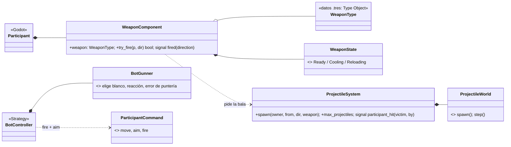

<!-- Sección §22 de docs/ARQUITECTURA.md (índice). -->
# §22. Disparo + pistola inicial

### Problema que resuelve el diseño
Todos los participantes (humanos y bots) tienen que poder disparar. Hacerlo "a lo bruto" tiene dos problemas:
un nodo por bala significa crear y destruir cientos de nodos por segundo, y meter la lógica del disparo dentro de
`Participant` o de cada controlador obligaría a reescribirla con las armas temporales (siguiente pieza).

### Solución: orden → arma → todas las balas en un sistema → evento
```
Controlador (humano / bot / red)  →  ParticipantCommand { move, aim, fire }
Participant.execute_command       →  WeaponComponent.try_fire(aim)   (cadencia y munición: WeaponState)
WeaponComponent                   →  ProjectileSystem.spawn(...)     (una sola lista de balas para todo el mapa)
ProjectileSystem (cada frame)     →  participant_hit(victim, by)     → match.gd: elimina (y suelta el trofeo)
```
Hoy **un balazo elimina**: la víctima vuelve a su base (`LifeComponent`, 3 s + 2 s de protección) y, si llevaba el
trofeo, cae al piso (`TrophyController.eliminate_participant`). Con la Etapa 4 el impacto quitará salud: solo cambia
quien escucha `participant_hit`, no el arma ni las balas.



| Pieza | Patrón | Por qué |
|---|---|---|
| `ParticipantCommand` (`aim_x/aim_y`, `fire`) | **Command** | El participante no sabe quién dispara (mouse, bot o red); se puede mandar por red tal cual. |
| `WeaponType` (`data/weapons/pistol.tres`) | **Type Object** (datos) | Cada arma es un archivo; las armas temporales serán solo .tres nuevos. Distancias en casillas. |
| `WeaponState` | **State** (enum) | Lista → enfriando → (recargando): pocos estados con temporizador, como `LifeCycle`. |
| `WeaponComponent` | **Composición** | Hijo del participante, igual que `StatsComponent` y `LifeComponent`. |
| `ProjectileWorld` + `ProjectileSystem` | **Datos en bloque + Object Pool** ("de juegos") | Las balas son structs en un `std::vector`; las que terminan se quitan por swap-remove. No es un pool de objetos prestados: es un arreglo que se reutiliza. Un solo `_draw` para todas. |
| `participant_hit` → `Events.participant_hit` | **Observer / Event Bus** | El arma no sabe qué pasa al impactar; lo decide la partida (hoy eliminar). |
| `BotGunner` | Percepción + error como datos | Va **aparte** de `BotBrain`: una `BotAction` elige *a dónde ir* y el bot tiene que moverse y disparar a la vez. |

**Choques.** Cada bala recorre el tramo que avanzó en el frame con el mismo DDA de la visión
(`segment_hits_wall`), así que aunque sea muy rápida no atraviesa una pared de 1 casilla, y si el laberinto vivo cierra
un pasaje, la bala choca con la pared nueva sin hacer nada especial. Contra los participantes: segmento contra círculo
(radio del cuerpo + radio de la bala); gana lo que se toque primero. Nunca le pega a quien la disparó; los eliminados y
los protegidos no son blanco.

**Bots.** Cada 0,15 s revisan a qué rivales VEN (radio de su stat de visión + línea de visión: juego limpio). Eligen al
más cercano dentro del alcance del arma, esperan su `reaction_time` (el mismo del perfil) y disparan con un desvío al
azar de ±`aim_error_deg` (`BotProfile`: Fácil 22°, Normal 14°, Difícil 8°, Experto 4°). La cadencia la pone el arma.

**Alcance = visión (v0.0.24).** Con `WeaponType.range_from_vision` el alcance real es la visión de quien dispara
× `range_vision_factor` (`lv::core::effective_range`): no se dispara "a la nada" y un power-up de visión también
alarga el alcance. Los bots usan el mismo alcance para decidir si disparan.

**Balas rápidas (v0.0.24).** La pistola va a 50 casillas/s (antes 16, "globitos"). Se dibuja como bala trazadora:
estela de lo recorrido en los últimos 0,03 s, que nunca sale del cuerpo del tirador (`Projectile.traveled`).

**Muerte (v0.0.27, solo vista): desintegración.** Al ser eliminado, el cuerpo se deshace en su lugar en 0,5 s con
`shaders/dissolve.gdshader`: lo divide en cuadraditos que desaparecen al azar (de afuera hacia adentro) con un borde
brillante de su color. A la vez, `death_effect.gd` suelta 26 "píxeles" de su color que se dispersan frenando, y deja
una "x" tenue en el piso (4 s). Al reaparecer crece desde chico con rebote y parpadea durante la protección.
*Error corregido:* en v0.0.24 el efecto tenía `z_index = -1` y quedaba **debajo del piso** (no se veía). Ahora el
efecto va en z 0 al final del nivel (sobre el piso) y los participantes en z 1 (pasan por encima de la marca).

**Humano.** Apunta con el mouse (o el stick derecho, acciones `aim_*`) y dispara con `fire` (clic izquierdo o gatillo
derecho); manteniendo apretado dispara a la cadencia del arma. El cursor de la partida es una cruz.

### Rendimiento
| Medición | Qué | Presupuesto |
|---|---|---|
| `weapons.projectiles` | Avance y choques de todas las balas (no corre si no hay balas) | < 0,3 ms con 256 balas |
| `bots.aim` | Gatillo de cada bot (la visión de rivales, cada 0,15 s) | < 0,1 ms |

- **Tope:** `ProjectileSystem.max_projectiles` = 256; al superarlo, la bala nueva reemplaza a la más vieja.
- **Simultaneidad:** todas las balas avanzan en un solo paso por frame y en orden fijo (resultado reproducible).
  Dos balas que le pegan al mismo blanco en el mismo frame: la segunda no hace nada (ya no es vulnerable).
- **Índice espacial:** no hace falta todavía. Con ≤ 8 participantes, revisar cada bala contra cada blanco
  (256 × 8) es más barato que consultar `EntityIndex`. Con los vándalos (decenas de blancos) se pasará a consultar
  el índice por bala.
- Las balas se redibujan cada frame (se mueven), pero en un solo `_draw` para todas.

### Archivos
| Archivo | Qué es |
|---|---|
| `src/core/participant_command.h` | `aim_x`, `aim_y`, `fire` |
| `src/core/weapon.{h,cpp}` | `WeaponSpec` (datos) y `WeaponState` (State) |
| `src/core/projectiles.{h,cpp}` | `ProjectileWorld`: balas, tope, avance y choques |
| `src/core/line_of_sight.{h,cpp}` | `segment_hits_wall`: dónde choca un segmento con una pared |
| `src/core/bot_gunner.{h,cpp}` | `BotGunner`: blanco, reacción y puntería |
| `tests/test_weapons.cpp` | 14 tests: cadencia, munición infinita, recarga, alcance, bala rápida contra pared, fracción del choque, blanco en el camino y nunca el tirador, blanco detrás de pared, tope, dirección nula; bots: sin rivales, reacción, el más cercano y alcance, error acotado y reproducible |
| `src/game/weapon_type.{h,cpp}` | Recurso `WeaponType` |
| `src/game/weapon_component.{h,cpp}` | Componente del participante |
| `src/game/projectile_system.{h,cpp}` | Nodo con todas las balas; señal `participant_hit` |
| `src/game/participant*.{h,cpp}` | Ejecuta `fire` con su arma; `HumanController` lee mouse / stick |
| `src/game/bot_controller.*`, `bot_coordinator.*` | Gatillo del bot; `collect_visible_rivals`; `BotProfile.aim_error_deg` |
| `src/game/trophy_controller.*` | `eliminate_participant`: elimina y, si era el portador, suelta el trofeo |
| `project/data/weapons/pistol.tres` | Pistola: 0,35 s entre disparos, munición infinita, 50 casillas/s, alcance = visión |
| `project/scripts/participant/death_effect.gd`, `participant_view.gd`, `project/shaders/dissolve.gdshader` | Desintegración y reaparición |
| `project/scenes/participant/participant.tscn` | Nodo `Weapon` con la pistola |
| `project/scenes/game/match.tscn`, `scripts/game/match.gd` | Nodo `Projectiles`; impacto = eliminar; avisos "TE DISPARÓ" / "LE DISTE A" |
| `project/project.godot` | Acciones `fire`, `aim_left/right/up/down` |

### Decisiones
- Impacto = eliminar (decisión del dueño, para probar). La salud llega en la Etapa 4 escuchando `participant_hit`.
- Avisos entre bots solo si el trofeo cayó (si no, habría un aviso por balazo).
- Las balas se ven con la luz como todo lo demás (niebla de guerra): una bala en la oscuridad no se ve.
- Pendiente (ROADMAP): armas temporales del mapa y su ficha en el HUD; bots que las buscan; sonido y destello (Etapa 7).
- Verificado en Godot: compila, 128 tests, la partida carga sin errores. Prueba en vivo y de estrés: el dueño.
