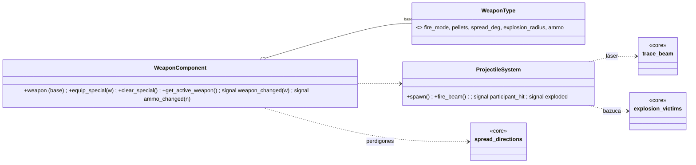

<!-- Sección §23 de docs/ARQUITECTURA.md (índice). -->
# §23. Catálogo de armas: escopeta, láser y bazuca

### Problema que resuelve el diseño
El juego necesita muchas armas. Si cada arma fuera una clase, 20 armas serían 20 clases con código casi repetido.
Además, por ahora el dueño quiere armas **básicas** (todas matan al impactar); su comportamiento propio se
especifica más adelante. Hacía falta una base que escale sin reescribir.

### Solución: cada arma es una combinación de piezas de datos
| Pieza (`WeaponSpec` / `WeaponType`) | Opciones | Uso |
|---|---|---|
| **Cómo dispara** (`fire_mode`, Strategy elegida por dato) | `Proyectil` · `Rayo` | pistola, escopeta y bazuca vuelan; el láser es instantáneo |
| **Perdigones** (`pellets`, `spread_deg`) | 1..24 en un cono, repartidos parejos (sin azar) | escopeta: 7 en 30° |
| **Impacto** (`explosion_radius`) | 0 = directo · >0 = explosión | bazuca: radio 2 casillas |
| **Munición** (`ammo`) | 0 = infinita · N disparos | pistola infinita; especiales con munición |
| **Alcance** (`range_from_vision` + factor) | visión × factor, o fijo | escopeta 0,75 × visión |

Un arma nueva que combine estas piezas = **un .tres, sin código** (ametralladora, francotirador, granada...).
Un comportamiento realmente nuevo (rebote, veneno, cargar el disparo) = una opción nueva en una de estas piezas.

**Inventario (decisión del dueño): pistola fija + 1 ranura especial.** `WeaponComponent.equip_special()` la equipa
sola y reemplaza a la anterior. Se vuelve a la pistola cuando la especial se queda sin munición o al ser eliminado.

| Pieza | Patrón | Por qué |
|---|---|---|
| `WeaponType` con `fire_mode`, perdigones, explosión, munición | **Type Object** + armas por composición de datos | Escala a un catálogo grande sin clases nuevas. |
| `fire_mode` (Proyectil / Rayo) | **Strategy** (elegida por dato) | Solo dos maneras de disparar; un `switch` en un lugar basta. Si crecen, pasarían a clases. |
| Ranura especial en `WeaponComponent` | **Composición** + State por arma | Cada arma lleva su propio `WeaponState` (cadencia y munición independientes). |
| `trace_beam`, `explosion_victims`, `spread_directions` | Funciones puras en `core` | Se prueban sin Godot; reutilizan el DDA de la visión. |

**Láser:** rayo instantáneo hasta la primera pared o el primer blanco, cada 0,15 s mientras se mantiene el clic
(30 disparos). **Bazuca:** cohete a 22 casillas/s que explota al chocar o al llegar a su alcance; la explosión le pega
a todos los que estén en el radio y tengan línea de visión con el centro (las paredes protegen). No hay daño propio
(decisión del dueño, por ahora). El punto de choque contra una pared se retrocede 0,05 casillas para que la explosión
no nazca dentro de la pared.

### Rendimiento
| Medición | Qué |
|---|---|
| `weapons.projectiles` | Balas + efectos (rayos y explosiones que se apagan) |
| `weapons.beam` | Un rayo de láser (al disparar) |

Escopeta: 7 balas por disparo; con 8 participantes con escopeta son ~70 balas por segundo, muy debajo del tope (256).

### Archivos
| Archivo | Qué es |
|---|---|
| `src/core/weapon.{h,cpp}` | `FireMode`, perdigones, explosión, munición total; `spread_directions` |
| `src/core/projectiles.{h,cpp}` | `trace_beam`, `explosion_victims`; balas con explosión |
| `tests/test_weapons.cpp` | +5 tests: cono parejo, munición que se gasta, rayo (primer blanco, tirador, paredes), explosión (radio, borde, paredes, tirador), choque sobre suelo |
| `src/game/weapon_type.*`, `weapon_component.*`, `projectile_system.*` | Datos, ranura especial, rayos y explosiones |
| `project/data/weapons/{pistol,shotgun,laser,bazooka}.tres` | El catálogo |
| `project/scripts/game/match.gd` | Teclas de prueba 4/5/6 (equipar) y 7 (volver a la pistola) |

### Decisiones
- Todas las armas matan al impactar (dueño). La especificación propia de cada arma queda para después.
- Al ser eliminado se pierde el arma especial.
- Verificado en Godot: compila, 135 tests, la partida carga sin errores. Prueba en vivo: el dueño.
