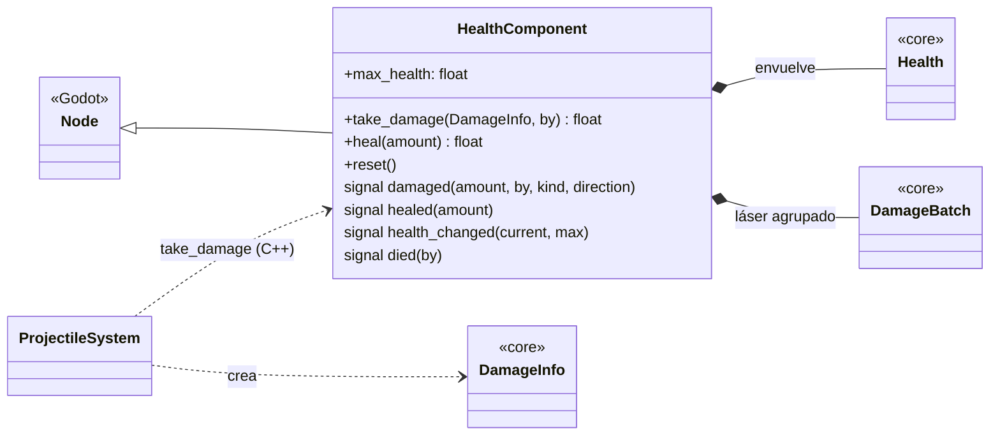

# §25. Etapa 4.1 — Salud y daño por arma

### Problema que resuelve el diseño
Hasta v0.0.31 una bala eliminaba en el acto (`ProjectileSystem.participant_hit` → `match.gd` → eliminar). Para el
combate hace falta salud, que cada arma pegue distinto (como dato) y que después se puedan meter escudos entre el
golpe y la salud sin tocar la salud ni las armas. Y todo sin pasar por GDScript por cada perdigón o frame de láser.

### Solución: un paquete de daño que viaja del arma a la salud
```
Arma (WeaponType.damage) ─► DamageInfo ─► [escudos, pieza 3] ─► HealthComponent ─► ¿0? ─► died ─► match.gd: pierde la vida
```
- **Bala / perdigón:** `damage` (pistola 20, escopeta 12 × 7).
- **Láser:** `damage × delta` cada frame (70/s). La salud baja en el acto; la señal `damaged` sale agrupada cada 0,25 s.
- **Explosión:** de `damage` en el centro a `damage_edge` en el borde (bazuca 80 → 30), según la distancia del centro al
  borde del cuerpo (`explosion_victims` ahora la devuelve).
- Al llegar a 0: `died(by)` → `match.gd` llama a `TrophyController.eliminate_participant` (suelta el trofeo si lo
  llevaba y `LifeComponent` lo saca y lo hace reaparecer). Al reaparecer, `Participant` llama `HealthComponent.reset()`.



| Pieza | Patrón | Por qué |
|---|---|---|
| `DamageInfo` | **Value Object** (como `ParticipantCommand`) | Un golpe es un dato simple y copiable: cantidad, quién, tipo, dirección, punto. Sirve para red, repeticiones y para los escudos. |
| `HealthComponent` | **Composición** | Un hijo más del participante, junto a `LifeComponent` y `WeaponComponent`. La salud no sabe de armas ni de trofeos. |
| `WeaponSpec.damage` / `damage_edge` | **Type Object + datos** | El daño se ajusta en el `.tres` sin código. |
| `DamageBatch` | Agrupador simple | El láser pega cada frame: sin agrupar habría una señal y un número flotante por frame. |
| Números de daño | **Object Pool** (existe) | `FloatingTextLayer` reutiliza etiquetas; los perdigones casi simultáneos se suman en un número. |
| Tarjeta: sección salud | **Composite** (existe) | Una sección nueva (`card_health.gd`), prevista en §24. |

La cadena de modificadores (escudos) **no se crea todavía**: llega en la pieza 3, entre `ProjectileSystem` y `Health`.

### Archivos
| Archivo | Qué es |
|---|---|
| `src/core/health.{h,cpp}` | `DamageInfo`, `DamageKind`, `Health`, `explosion_damage`, `DamageBatch` |
| `src/core/projectiles.{h,cpp}` | `ExplosionVictim` (id + distancia); `ProjectileEvent` lleva la dirección de la bala |
| `src/core/weapon.h` | `WeaponSpec.damage` y `damage_edge` |
| `tests/test_health.cpp` | 13 tests: balas, tope, láser en trocitos, curar, reset, caída de la explosión, agrupado |
| `src/game/health_component.{h,cpp}` | Componente de salud (señales finales para la vista) |
| `src/game/projectile_system.cpp` | Arma el `DamageInfo` y lo aplica directo; `participant_hit` solo si no hay salud |
| `project/data/weapons/*.tres` | Daños: pistola 20, escopeta 12, láser 70/s, bazuca 80 → 30 |
| `project/scripts/ui/player_card/card_health.gd` | Sección SAL: barra con color por nivel y rastro blanco de lo perdido |
| `project/scripts/ui/low_health_border.gd` | Borde rojo que late con salud < 30 |
| `project/scripts/participant/participant_view.gd` | Destello blanco (0,08 s) y barrita sobre rivales (2,5 s) |
| `project/scripts/ui/floating_text_layer.gd` | Números de daño (`Events.participant_damaged`) |
| `project/scripts/game/match.gd` | `died` → pierde la vida; sacudida de cámara con explosiones cercanas; tecla 8 = recibir 25 |

### Decisiones
- Salud 100, vidas infinitas (sin corazones en la tarjeta). El trofeo cae al **perder la vida**, no con cada golpe.
- Solo se recibe daño siendo vulnerable (vivo y sin protección). Con 0, los golpes siguientes no hacen nada.
- `Events.participant_hit` pasó a `Events.participant_damaged(victim, by, amount, kind)`.
- La barrita de salud aparece sobre cualquier participante que no controle una persona, tras cualquier golpe.
- Medición nueva: `combat.damage` (por golpe aplicado).
- Bots: sin cambios de conducta.
- Verificado en Godot: compila, 151 tests, la partida carga sin errores y la tarjeta muestra la sección SAL.
  La prueba en vivo (sensación de los daños) la hace el dueño.
