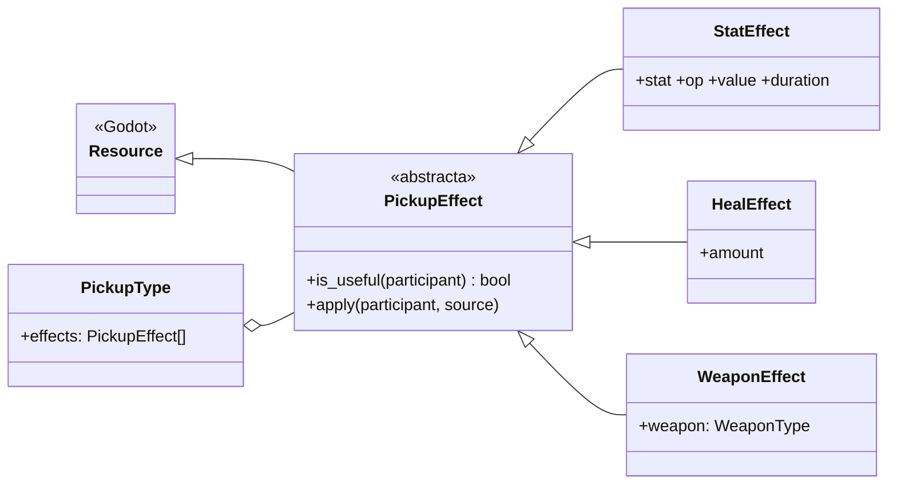

# §26. Etapa 4.2 — Pociones y efectos de objeto (Strategy)

### Problema que resuelve el diseño
Hasta v0.0.33 `PickupEffect` solo sabía cambiar stats, y el arma era un campo aparte del `PickupType`. Con las
pociones (curar), y pronto los escudos (pieza 3) y las bombas (pieza 4), `Pickup::collect` habría crecido con un
`if` por cada clase de efecto, y cada objeto nuevo habría pedido tocar código.

### Solución: cada efecto sabe aplicarse
`PickupEffect` es la base abstracta con dos métodos: `is_useful(participant)` y `apply(participant, source)`.
Un `PickupType` tiene una lista de efectos (.tres); `Pickup::collect` solo pregunta si alguno sirve y los aplica.

| Pieza | Patrón | Por qué |
|---|---|---|
| `PickupEffect` + subclases | **Strategy + datos** | Un efecto nuevo (escudo, bomba) = una subclase; `Pickup` y los demás efectos no cambian. Se arma en el inspector como sub-recurso del `.tres`. |
| `is_useful` | Regla del efecto | La poción con la salud llena no se gasta: se queda en el piso para otro. |
| `HealEffect` → `HealthComponent.heal` | Reutiliza §25 | La lógica de curar (tope, no revivir) ya estaba en `lv::core::Health`, con tests. |

**Pociones:** pequeña +25 (peso 3, común) y grande +60 (peso 1, rara, con título "¡POCIÓN!"), en su propia
categoría de aparición `data/spawning/pociones.tres`. Forma nueva **frasco** con símbolo **cruz** (§21).
Al curarse: destello verde del cuerpo, texto flotante "+25 SAL" y la barra SAL de la tarjeta destella verde.

### Archivos
| Archivo | Qué es |
|---|---|
| `src/game/pickup_effect.{h,cpp}` | `PickupEffect` (abstracta), `StatEffect`, `HealEffect`, `WeaponEffect` |
| `src/game/pickup_type.{h,cpp}` | `is_useful_for` y `apply_to`; formas `SHAPE_FLASK` y `SYMBOL_CROSS`; sin campo `weapon` |
| `src/game/pickup.cpp` | `collect` delega en los efectos |
| `project/data/pickups/pocion_*.tres` | Las dos pociones |
| `project/data/pickups/*.tres` | Migrados: `StatEffect` (puntos y power-up) y `WeaponEffect` (armas) |
| `project/data/spawning/pociones.tres` | Categoría de aparición (agregada en `match.tscn`) |
| `project/scripts/pickups/pickup_view.gd` | Dibujo del frasco y la cruz |
| `project/scripts/ui/effect_text.gd` | Texto por tipo de efecto ("+25 SAL") |
| `project/scripts/participant/participant_view.gd` | Destello verde al curarse |

### Decisiones
- No hay lógica nueva en `core`: curar ya estaba probado en `Health` (§25). Los efectos solo adaptan.
- El texto de cada efecto vive en la interfaz (`EffectText`), no en C++.
- Con la salud llena la poción no se recoge. Como la detección es al entrar, si estás parado encima y luego te
  dañan, hay que salir y volver a entrar (anotado en el ROADMAP).
- Verificado en Godot: compila, 151 tests, la partida carga y los `.tres` migrados cargan sus efectos; captura de
  los frascos junto a los demás objetos. La prueba en vivo la hace el dueño.
