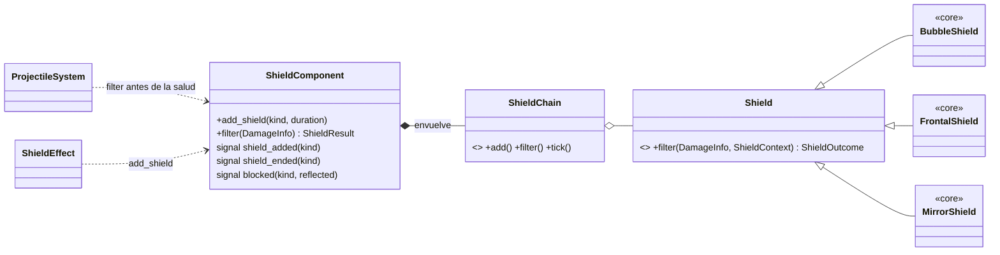

# §27. Etapa 4.3 — Escudos (cadena de modificadores)

### Problema que resuelve el diseño
Tres escudos que tratan el daño de forma distinta (absorber un golpe, parar solo lo de delante, devolver el
disparo) y que pueden estar activos a la vez. Si cada uno fuera un `if` dentro de la salud o de `ProjectileSystem`,
cada escudo nuevo tocaría código ya probado y el orden entre ellos quedaría escondido.

### Solución: el golpe pasa por una cadena de eslabones antes de la salud
```
Arma ─► DamageInfo ─► [Burbuja] ─► [Frontal] ─► [Espejo] ─► Salud
                         │            │            └─ Reflected: vuelve a quien disparó
                         └────────────┴─ Absorbed: la salud ni se entera
```
- **Burbuja** (20 s o hasta romperse): absorbe UN golpe entero, de cualquier tipo. Contra el láser aguanta 35 de
  daño (medio segundo) y se rompe.
- **Frontal** (8 s): anula lo que viene de delante, ±60° de hacia donde apunta. No se gasta.
- **Espejo** (5 s): devuelve balas (vuelven como bala nueva del que tiene el espejo) y láser (quema directo a quien
  lo dispara). Las explosiones lo atraviesan. Un golpe ya devuelto no se vuelve a devolver (sin ping-pong).
- Mismo tipo no se apila: recoger otro renueva el tiempo. Al perder la vida se pierden todos.



| Pieza | Patrón | Por qué |
|---|---|---|
| `Shield` + `ShieldChain` | **Chain of Responsibility** | Cada escudo decide pasar, anular o devolver. Escudo nuevo = eslabón nuevo; ni la salud ni los demás escudos cambian. El orden es explícito y probado. |
| `ShieldComponent` | **Composición** | Un hijo más del participante. La salud no sabe de escudos. |
| `ShieldEffect` | **Strategy + datos** (§26) | Los objetos de escudo son `.tres` con un efecto más. |
| `DamageInfo.reflected` | Value Object (§25) | El golpe devuelto lleva la marca; así otro espejo no lo devuelve. |

**Rendimiento:** filtrar es C++ en el mismo paso que el daño (`combat.shields`). `blocked` del láser se avisa a
GDScript como mucho cada 0,25 s. El componente solo procesa mientras hay escudos; la vista, igual.

### Archivos
| Archivo | Qué es |
|---|---|
| `src/core/shields.{h,cpp}` | `Shield`, `BubbleShield`, `FrontalShield`, `MirrorShield`, `ShieldChain` |
| `tests/test_shields.cpp` | 9 tests: sin escudos, burbuja (y contra láser), cono frontal, espejo, orden, renovar, tiempos |
| `src/core/projectiles.*`, `src/core/health.h` | Marca `reflected` en balas, eventos y `DamageInfo` |
| `src/game/shield_component.{h,cpp}` | Componente de escudos (duraciones editables) |
| `src/game/projectile_system.cpp` | Filtra antes de la salud; `reflect()` devuelve balas y láser |
| `src/game/pickup_effect.*` | `ShieldEffect` |
| `src/game/participant.*` | `get_shields()`, `get_aim()`; pierde los escudos al perder la vida |
| `project/data/pickups/escudo_*.tres`, `data/spawning/escudos.tres` | Objetos (rombos azules) y su categoría |
| `project/scripts/participant/shield_view.gd` | Anillo / arco / anillo plateado; parpadeo al acabarse; destello al bloquear |
| `project/scripts/ui/player_card/card_effects.gd` | Fichas BURBUJA / FRONTAL / ESPEJO con su tiempo |
| `project/scripts/ui/floating_text_layer.gd` | "BLOQUEADO", "¡PUM! BURBUJA", "¡DEVUELTO!" (`Events.shield_blocked`) |

### Decisiones
- Duraciones y ángulo como propiedades del `ShieldComponent` (se ajustan sin código); un `ShieldEffect` puede
  dar otra duración.
- Orden de la cadena tal como se aprobó: Burbuja → Frontal → Espejo (la burbuja se gasta primero).
- Tecla de prueba 9: los tres escudos a la vez.
- Bots: sin cambios de conducta (recogen escudos al pasar).
- Verificado en Godot: compila, 160 tests, la partida carga; captura de los objetos y de los tres escudos
  dibujados. La prueba en vivo la hace el dueño.
